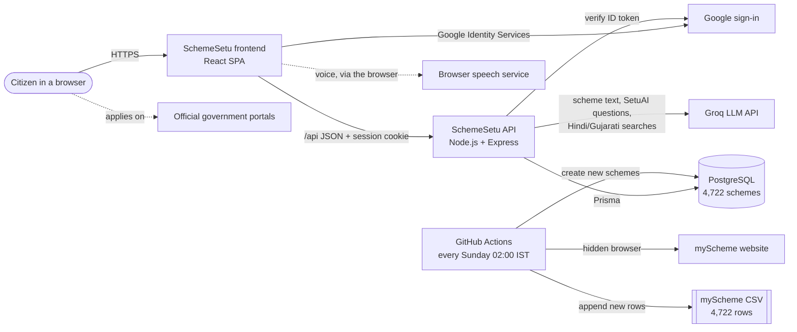
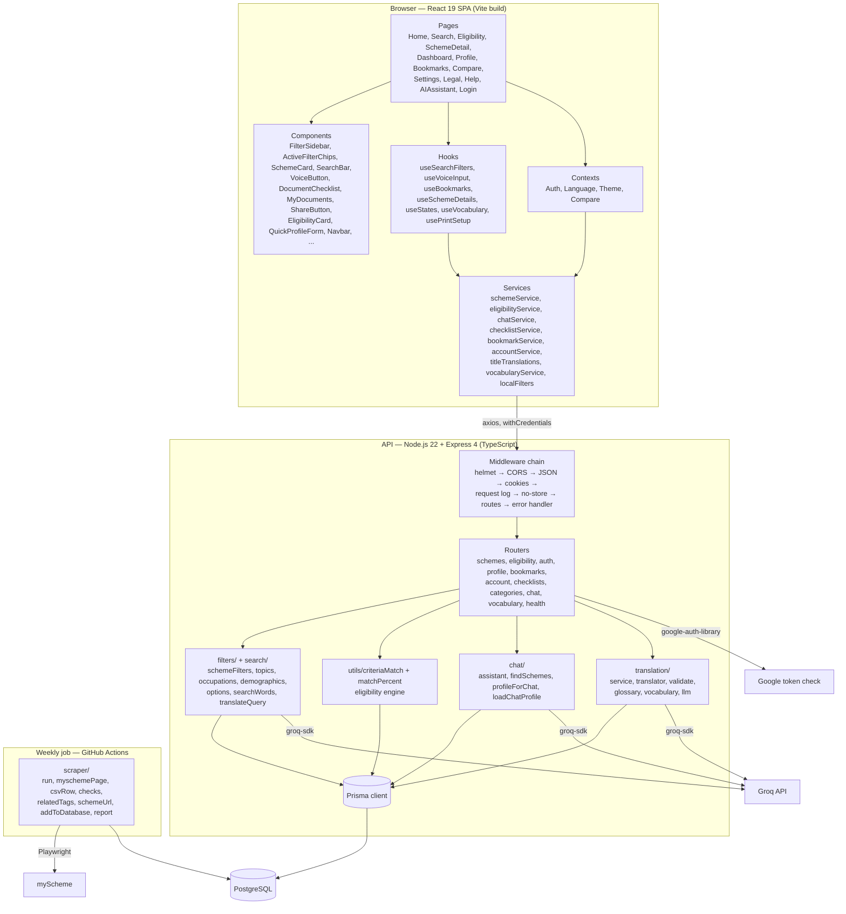
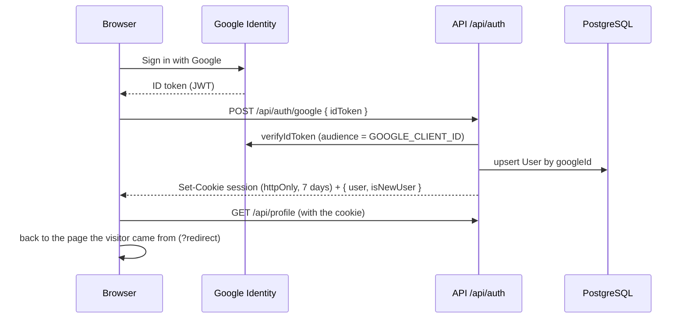
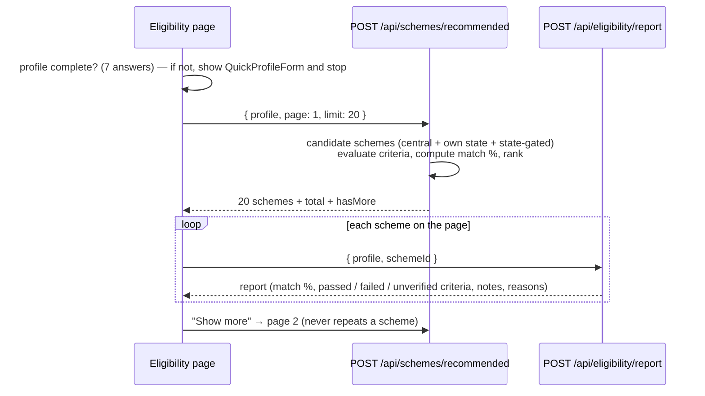
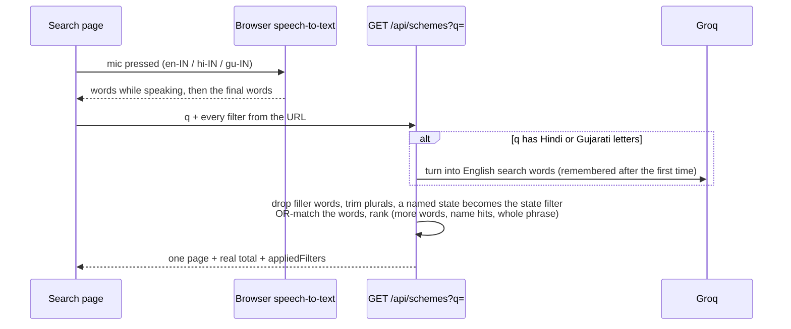
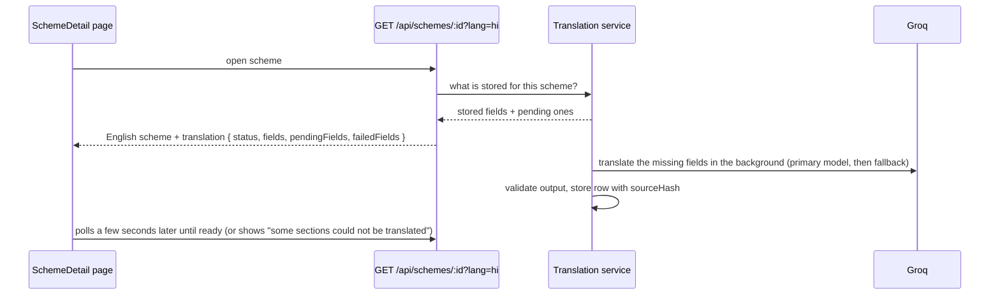
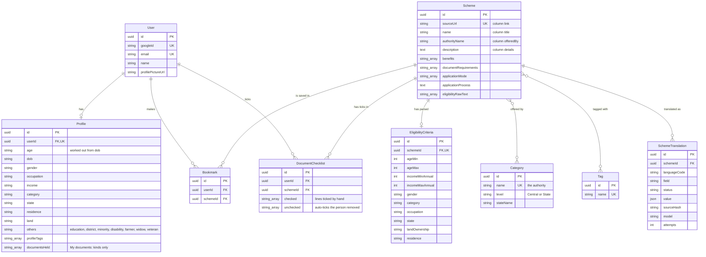
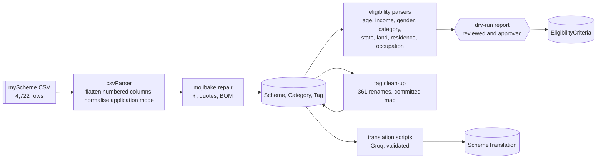
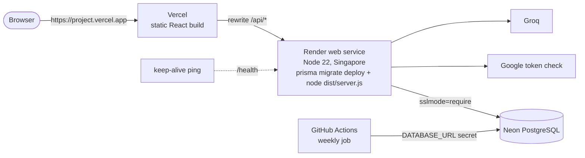

# SchemeSetu — Project Details (living SRS)

| | |
|---|---|
| **Product** | SchemeSetu (स्कीमसेतु) — a finder for Indian government welfare schemes |
| **Document type** | Software Requirements Specification, structured after IEEE 830 / ISO/IEC/IEEE 29148, kept up to date |
| **Last updated** | 2026-11-14 (typo-tolerant search, recently viewed, SetuAI read aloud, simple mode, WhatsApp summary, scheme reports, APK guide) |
| **Project** | Project-I (CEUP 301), Department of Computer Science & Engineering, CSPIT, CHARUSAT — Group CS26015 |
| **Student** | Urja Gajera (24CS021) |
| **Mentor / Guide** | Dr. Jigar Sarda |
| **Repository** | `github.com/Urjagajera/SchemeSetu`, branch `master` (230 commits, 2026-07-13 to 2026-11-06) |
| **Source of every number** | Measured from the code, the local database and the test runs on the date it gives. Nothing is estimated unless it says so. |

> **This is the living copy of the SRS.** It describes the system **as built today** and is updated whenever a module is finished or a
> decision changes something (see section 19 for how, and the decision log). `docs/SchemeSetu-SRS.md` is the frozen version of
> 2026-10-21 that was submitted then; where the two differ, this file is current.
> Requirements are written in the "shall" form; each one is implemented unless section 16 (Known limitations) says otherwise.

---

## Table of contents

1. [Introduction](#1-introduction)
2. [Overall description](#2-overall-description)
3. [System architecture](#3-system-architecture)
4. [Technology stack](#4-technology-stack)
5. [Functional requirements](#5-functional-requirements)
6. [Eligibility engine specification](#6-eligibility-engine-specification)
7. [Search and filter specification](#7-search-and-filter-specification)
8. [Language and translation specification](#8-language-and-translation-specification)
9. [Data requirements](#9-data-requirements)
10. [External interface requirements](#10-external-interface-requirements)
11. [Non-functional requirements](#11-non-functional-requirements)
12. [Quality assurance: testing and CI](#12-quality-assurance-testing-and-ci)
13. [Deployment and operations](#13-deployment-and-operations)
14. [Project structure](#14-project-structure)
15. [Design and implementation constraints](#15-design-and-implementation-constraints)
16. [Known limitations and future work](#16-known-limitations-and-future-work)
17. [Project deliverables](#17-project-deliverables)
18. [Appendices](#18-appendices)
19. [Decision log and change history](#19-decision-log-and-change-history)

---

## 1. Introduction

### 1.1 Purpose
India runs thousands of central and state welfare schemes, and a citizen has no simple way to find the few that fit them. SchemeSetu
collects **4,722 schemes** (with **436 more** found on myScheme and queued for the weekly update, section 9.6) into one searchable catalogue
and tells a person, from a few answers about themselves, **which schemes they are likely to be eligible for and why**. This document
specifies what the system does, how it is built, and the qualities it must have.

### 1.2 Intended audience
- The project mentor and examiners (Project-I evaluation).
- Developers maintaining or extending the code.
- Anyone deploying or operating the system.

### 1.3 Product scope
**In scope**
- A public catalogue of central and state schemes with word-by-word search (typed or spoken) and structured filters.
- An eligibility check: a 3-step guest wizard, and an automatic check from a signed-in user's saved profile.
- A ranked "recommended for you" list with a match percentage and the reasons behind it.
- Scheme detail pages with Share and Print, a document checklist, bookmarks, side-by-side comparison of up to 3 schemes.
- **SetuAI**, an AI assistant that answers questions from SchemeSetu's own scheme data (Groq, free tier).
- **Voice search** in English, Hindi and Gujarati (the browser's own speech-to-text).
- Interface in **English, Hindi and Gujarati**; scheme text in **English, Hindi and Gujarati** (machine translated, marked as such, with a switch back to English).
- Google sign-in, a saved profile (age worked out from the date of birth), "My documents", account data export and account deletion.
- Privacy Policy and Terms pages that state only what the code does.
- A **weekly automatic check** of myScheme that adds new schemes to the CSV and the database (never changes existing ones).
- **Comfort and help:** typo-tolerant search ("scolarship" finds scholarships), recently viewed schemes on the dashboard, SetuAI answers read aloud (optional), a large-text simple mode, a WhatsApp/share message with the benefit and document list, and "Report a problem with this scheme" (anonymous).

**Out of scope** (not built and not promised)
- Applying for a scheme inside SchemeSetu (users are sent to the official portal).
- Payments, notifications, e-mail, an admin panel, native mobile apps.
- Changing or deleting existing schemes automatically when myScheme edits or removes them (they are only reported).

SchemeSetu is an **independent information service, not a government website**, and the interface says so.

### 1.4 Definitions, acronyms and abbreviations

| Term | Meaning |
|---|---|
| Scheme | A government welfare programme (central or state) |
| Central / State scheme | Who offers it, derived from the authority name: a state or union territory name means State, anything else Central |
| Authority | The ministry, department or state that offers a scheme (`Scheme.authorityName`) |
| Criteria | The structured eligibility conditions parsed from a scheme's text (`EligibilityCriteria`) |
| Hard criterion | A condition that can exclude a scheme (age, income, gender, social category, state, land, residence) |
| Soft criterion | A condition that only changes ranking and adds a note (occupation) |
| Unknown | A profile answer left blank; it never excludes a scheme |
| Match % | The "Overall match" shown on an eligibility card (section 6.4) |
| Topic | A "What you need" filter group (16 groups built from tags, section 7.3) |
| myScheme | The Government of India's scheme portal, `www.myscheme.gov.in`, the source of all scheme data |
| SetuAI | SchemeSetu's assistant: retrieval from the scheme data, answer written by an LLM (section 5.8) |
| Related tags | Extra tag words the CSV adds after a scheme's page tags (e.g. "Farmer" → "Farming"); learned for new schemes (section 9.6) |
| Self-check | The weekly job re-reading 5 known schemes before writing anything (section 9.6) |
| SC / ST / OBC | Scheduled Caste / Scheduled Tribe / Other Backward Class |
| CSC | Common Service Centre (government-run help kiosks) |
| SPA | Single-page application |
| LLM | Large language model (Groq: translation, SetuAI, Hindi/Gujarati search words) |
| TPD / TPM | Tokens per day / tokens per minute (Groq quota) |
| CI | Continuous integration (GitHub Actions) |
| Dry run | A run that reads everything and writes nothing, to check before changing data |

### 1.5 References
- `README.md` — setup and commands.
- `docs/SchemeSetu-SRS.md` — the SRS as submitted on 2026-10-21 (frozen).
- `docs/SchemeSetu-Project-Book.md` — decision log, standing rules, history up to 2026-10-13.
- `docs/*.md` — one note per module (account data, compare page, dependency audit, Gujarati hardening, Hindi label, Hindi summaries,
  Hindi title clean-up and fixes, honest copy, privacy and terms, recommended pagination, removed pages, session cookie, UI strings).
- `backend/prisma/schema.prisma`, `backend/prisma/migrations/` — the database.
- `.github/workflows/ci.yml`, `.github/workflows/new-schemes.yml`, `render.yaml`, `vercel.json` — CI, the weekly job, deployment.
- Data source: myScheme (`www.myscheme.gov.in`), exported into `backend/data/final_data_without_process_mode_.csv` and kept current by
  the weekly job (`backend/src/scraper/`).

### 1.6 Overview of this document
Sections 2–4 describe the product, its architecture and technology. Sections 5–8 are the functional requirements, with the eligibility
engine, search and the translation pipeline specified in detail. Section 9 covers data (including the weekly update), 10 the interfaces,
11 the non-functional requirements, 12–13 testing, deployment and operations, 14 the code layout, 15 constraints, 16 known limitations,
17 deliverables, 18 appendices, and 19 the decision log.

---

## 2. Overall description

### 2.1 Product perspective
SchemeSetu is a self-contained web application with three tiers: a React SPA, an Express JSON API, and a PostgreSQL database. Outside
services it depends on:
- **Google Identity** — sign-in.
- **Groq** (free tier) — translating public scheme text into Hindi, writing SetuAI's answers, and turning Hindi/Gujarati searches into
  English search words.
- **The browser's speech-to-text** (Web Speech API) — voice input; Chrome and Edge send the voice to Google or Microsoft, Safari may do
  it on the device or send it to Apple. SchemeSetu never receives the recording.
- **GitHub Actions + myScheme** — the weekly job that reads myScheme and adds new schemes.



### 2.2 Product functions (summary)
1. Browse and search schemes word by word, by typing or speaking; filter by who you are, what you need, and who runs the scheme.
2. Check eligibility (guest wizard or saved profile) and get a ranked list, 100% matches first, with reasons.
3. Open a scheme: description, benefits, eligibility, documents (with a checklist), how to apply, official link, related schemes;
   share it or print it.
4. Ask SetuAI questions in English, Hindi or Gujarati and get answers drawn only from SchemeSetu's scheme data, with links.
5. Bookmark schemes and compare up to 3 side by side.
6. Keep a profile and "My documents"; answer the missing profile questions right on the dashboard or the eligibility page.
7. Use the app in English, Hindi or Gujarati; read Hindi scheme text with a one-click switch back to the English original.
8. Export or delete one's own account data.
9. (Automatic) Every week, new schemes on myScheme are found and added; schemes that disappeared are reported.

### 2.3 User classes and characteristics

| User class | Description | Sign-in | Main functions |
|---|---|---|---|
| Guest visitor | Anyone arriving at the site; may have low digital literacy; may prefer Hindi or Gujarati | No | Home, Search (with voice), scheme pages (Share, Print, checklist not saved), eligibility wizard, Privacy and Terms |
| Signed-in citizen | Has signed in with Google | Yes | Everything: also profile, recommendations, SetuAI page, Help, bookmarks, compare, saved checklist, My documents, dashboard, settings, export/delete |
| Helper (NGO / CSC operator, student volunteer) | Uses the app on someone else's behalf | Optional | Same as a citizen; the guest wizard needs no account |
| Operator (project owner) | Runs ingestion and translation scripts, the weekly job's secrets, deploys | Not a product user | npm scripts, GitHub Actions, the hosting dashboards |

There is **no admin role** inside the app and **no demo login**: sign-in is real Google sign-in only.

### 2.4 Operating environment
- **Client:** a current desktop or mobile browser with JavaScript enabled (Chrome, Edge, Firefox, Safari). Voice input needs Chrome, Edge,
  Safari or Android's browser; Firefox has no speech-to-text, so the mic button is hidden there.
- **Server:** Node.js 22 (`engines: node >= 20`), PostgreSQL 14 or newer.
- **Local development:** API on `http://localhost:3001`, Vite dev server on `http://localhost:5173` with `strictPort` (it stops with an
  error instead of moving to 5174, because Google sign-in only accepts the 5173 origin); `/api` is proxied to 3001; local PostgreSQL.
- **Weekly job:** GitHub Actions on Ubuntu 24.04 (pinned; Playwright 1.56.1 cannot install its browser on Ubuntu 26), Node 22, Playwright's Chromium.
- **Planned production:** Vercel (frontend), Render (API, Singapore region), Neon (PostgreSQL) — all free tiers (section 13).

### 2.5 Design and implementation constraints (summary; full list in section 15)
- Free tiers only; nothing may cost money.
- Hindi scheme text on, Gujarati scheme text off until a native speaker reviews it; the interface is available in all three languages.
- The interface may only state things that are true; AI answers are labelled as AI and can be wrong.
- Automation may only **add** schemes; it never edits or deletes existing ones.
- TypeScript everywhere; both test suites, both typechecks and both builds pass before every push.

### 2.6 Assumptions and dependencies
1. The catalogue comes from myScheme. New schemes are added weekly (up to 200 a run); edits to existing schemes on myScheme are **not**
   copied automatically.
2. Users confirm details on the official portal before applying; SchemeSetu's result is guidance, not a decision.
3. Google Identity and Groq stay available on their free plans. If Groq fails or its daily quota runs out: translation falls back to
   English visibly, SetuAI lists the matching schemes instead of writing an answer, and Hindi/Gujarati searches are searched as written.
4. In production the browser reaches the API through the frontend's own address (Vercel rewrites `/api/*` to Render), so the session cookie
   is first-party.
5. myScheme keeps its page layout; if it changes, the weekly job's self-check stops the run before anything is written.

---

## 3. System architecture

### 3.1 High-level architecture



### 3.2 Request lifecycle (backend middleware order)
Defined in `backend/src/app.ts`; the order matters:

1. `app.set('trust proxy', N)` from `TRUST_PROXY_HOPS` (2 in production: browser → Vercel → Render), and `etag` disabled.
2. `helmet()` — security headers.
3. `cors({ origin: CLIENT_URL, credentials: true })` — one fixed origin, never `*`.
4. `express.json()` — JSON bodies.
5. `cookieParser()` — reads the session cookie for `requireAuth` (and, optionally, for SetuAI's profile use).
6. `requestLogger` — Pino log line per request (method, path, status, duration).
7. `/api/*` responses get `Cache-Control: no-store`.
8. Routers (section 10.2). `chatLimiter` sits in front of `/api/chat`; `authLimiter` on sign-in.
9. `errorHandler` — one JSON error shape `{ error: { message, status } }`; no stack traces in production.

### 3.3 Frontend architecture
- **Routing** (`src/routes/AppRoutes.tsx`, React Router 7):
  - **Public:** `/`, `/login`, `/register`, `/eligibility`, `/privacy`, `/terms`, `/search`, `/schemes/:id`.
  - **Signed-in only:** `/help`, `/ai` (SetuAI), and the dashboard layout pages `/dashboard`, `/bookmarks`, `/compare`, `/profile`,
    `/settings`. A signed-out visitor is sent to `/login?redirect=<page>` and brought back after sign-in; the Login button also remembers
    the page it was pressed on.
  - Unknown paths show a 404 page.
- **State:**
  - `AuthContext` — user, profile, `updateProfile`, Google sign-in, logout. The profile is the single source for "About you" answers.
  - `LanguageContext` — `en` / `hi` / `gu` dictionaries from `locales/*.json`; the choice is kept in `localStorage` and set as the page's
    `lang`, so screen readers use the right voice.
  - `ThemeContext` — light / dark.
  - `CompareContext` — up to 3 schemes to compare.
  - **The URL** — every Search filter lives in the query string (`useSearchFilters`), so reload, back and shared links keep the same results.
- **Services** wrap every API call with `axios` (`withCredentials: true`) and check that real JSON came back. When schemes cannot be loaded,
  pages say so and offer **Try again** (they no longer show sample schemes). `VITE_USE_MOCK_DATA=true` switches to bundled demo data.
- **Styling:** Tailwind CSS 4 with a design-token palette (primary navy `#002045`, secondary blue `#1960A3`, light surfaces), fonts Inter
  and Outfit, Framer Motion transitions, Lucide icons, dark mode. Small text is at least 12 px and grows with the browser's text size.

### 3.4 Backend module map

| Folder | Responsibility |
|---|---|
| `routes/` | HTTP endpoints (one router per resource) |
| `filters/` | Search filters: every query parameter read and checked in one place (`schemeFilters.ts`), topics, occupations, demographic rules, option lists with counts |
| `search/` | Word-by-word search: search words, state named in the search, ranking (`searchWords.ts`); Hindi/Gujarati search → English words via Groq, remembered (`translateQuery.ts`) |
| `chat/` | SetuAI: question → search words → schemes → answer (`assistant.ts`), scheme finder (`findSchemes.ts`), the eligibility-only profile fields (`profileForChat.ts`, `loadChatProfile.ts`) |
| `utils/` | Eligibility engine (`criteriaMatch.ts`), match percentage, Central/State level, the 36 states and UTs, profile validation, age from date of birth, document kinds, session cookie, scheme serialiser, logger, async handler, trust-proxy parsing |
| `middleware/` | `requireAuth`, rate limiters, request logger, error handler |
| `translation/` | Translation service, model calls with fallback (`llm.ts`, the only file that talks to Groq), output validator, glossary, vocabulary, batch scripts |
| `ingestion/` | CSV parser, mojibake repair, eligibility / demographic / state / land / residence / occupation parsers, tag clean-up, dry-run reports |
| `scraper/` | The weekly myScheme job (section 9.6) |
| `db/` | One shared Prisma client |
| `config/` | Typed environment configuration (nothing else in the server reads `process.env`; the weekly job opens its own connection with `DATABASE_URL` only) |

### 3.5 Key sequences

**Sign-in**


**Eligibility check (signed in)**


**Search (typed or spoken)**


**SetuAI**
```mermaid
sequenceDiagram
    participant C as Chat page
    participant A as POST /api/chat/message
    participant Q as Groq (gpt-oss-20b)
    participant D as PostgreSQL
    C->>A: { text, history (last 6), language }
    A->>D: signed in? load the eligibility-only profile fields
    A->>Q: question (+ history, profile) → English search words (JSON)
    A->>D: find schemes (named state filters; hard-criteria failures dropped)
    A->>Q: answer only from these schemes, in the page language, ≤ 180 words
    A->>A: remove any link that is not to a given scheme, Search or Eligibility
    A-->>C: { text, source: "ai" } — or, if Groq fails, a list of the matching schemes { source: "fallback" }
```

**Weekly myScheme check** — see section 9.6.

**Scheme page in Hindi**


---

## 4. Technology stack

### 4.1 Frontend

| Technology | Version | Purpose |
|---|---|---|
| React | 19.2 | UI library |
| TypeScript | 7.0 | Static typing |
| Vite | 5.4 | Dev server (port 5173, strict) and production build |
| React Router DOM | 7.18 | Client-side routing, URL-based filter state |
| Tailwind CSS (+ `@tailwindcss/postcss`, autoprefixer) | 4.3 | Styling, design tokens, dark mode |
| Framer Motion | 12.42 | Page and component animation |
| Lucide React | 1.24 | Icons |
| React Hook Form + `@hookform/resolvers` | 7.81 / 5.4 | Profile form |
| Zod | 4.4 | Form validation schemas |
| Axios | 1.18 | HTTP client (cookies sent with every request) |
| clsx + tailwind-merge | 2.1 / 3.6 | Class-name composition (`utils/cn.ts`) |
| Web Speech API (browser) | — | Voice input (`useVoiceInput`) |
| Web Share API (browser) | — | Share sheet on phones; WhatsApp / Copy link menu on computers |
| Google Fonts | — | Inter (body), Outfit (display) |
| vite-plugin-pwa (Workbox) | 1.2.0 | Installable app: manifest, icons (`public/icons/`), service worker in production builds only |

### 4.2 Backend

| Technology | Version | Purpose |
|---|---|---|
| Node.js | 22 (min 20) | Runtime, ES modules |
| Express | 4.19 | HTTP API |
| TypeScript | 5.4 | Typing; `tsx` in development, `tsc` build for production |
| Prisma (client + CLI) | 5.22 | ORM, migrations |
| PostgreSQL | 14+ (local: 18) | Database |
| google-auth-library | 11.1 | Verifies Google ID tokens |
| jsonwebtoken | 9.0 | HS256 session token |
| cookie-parser | 1.4 | Reads the session cookie |
| helmet | 8.3 | Security headers |
| cors | 2.8 | Fixed-origin CORS with credentials |
| express-rate-limit | 8.7 | Rate limits on sign-in and chat |
| zod | 4.6 | Request validation (profile, chat, checklists) |
| groq-sdk | 1.6 | LLM calls (translation, SetuAI, search words) |
| csv-parse | 7.0 | Dataset ingestion and the weekly job |
| Playwright | 1.56.1 (exact, dev) | Hidden browser for the weekly myScheme job |
| pino + pino-pretty | 9.0 / 11.0 | Structured logging |
| dotenv | 16.6 | Local environment files |

### 4.3 AI models (all through Groq, free plan)

| Role | Model | Use | Setting |
|---|---|---|---|
| Translation, primary | `openai/gpt-oss-120b` | Hindi titles, summaries and detail text | `TRANSLATION_PRIMARY_MODEL` |
| Translation, fallback | `qwen/qwen3.8-27b` | Used automatically when the primary fails validation or its quota is gone | `TRANSLATION_FALLBACK_MODEL` |
| SetuAI and search words | `openai/gpt-oss-20b` (small, fast) | SetuAI's search words and answers; Hindi/Gujarati search → English words | `CHAT_MODEL` |

Each model has about 200,000 tokens per day and 8,000 per minute on the free plan. What is sent to Groq is listed in section 9.5.

### 4.4 Testing and tooling

| Tool | Version | Use |
|---|---|---|
| Vitest | 2.1 | Test runner (both halves) |
| Testing Library (React, DOM, user-event) + jsdom | 16.3 / 10.4 / 14.6 / 26.1 | Frontend component and page tests |
| Supertest | 7.3 | Backend HTTP tests |
| GitHub Actions | — | CI on every push to `master` and every pull request; the weekly job |
| Git | — | Version control (master branch only) |

### 4.5 Hosting (planned, free tiers)

| Service | Hosts | Notes |
|---|---|---|
| Vercel (Hobby) | Frontend static build | Rewrites `/api/*` to Render so the cookie is first-party |
| Render (Free web service) | API | Region Singapore; sleeps when idle; health check `/health` |
| Neon (Free) | PostgreSQL | Direct connection string with `sslmode=require`; also the weekly job's database (GitHub secret `DATABASE_URL`) |
| Google Cloud | OAuth client | Allowed JavaScript origins: `http://localhost:5173` and, once deployed, the Vercel address |
| GitHub Actions | The weekly job | Free for public repositories |

---

## 5. Functional requirements

Priority: **H** high (core), **M** medium, **L** low. All listed requirements are implemented.

### 5.1 Authentication, session and access

| ID | Requirement | Priority |
|---|---|---|
| FR-AUTH-1 | The system shall let a user sign in with Google only (no passwords, no demo account). | H |
| FR-AUTH-2 | The API shall verify the Google ID token server-side against `GOOGLE_CLIENT_ID` and create the user on first sign-in. | H |
| FR-AUTH-3 | The API shall issue a session as an HS256 JWT in an httpOnly cookie that lasts 7 days (`Secure` + `SameSite=None` in production, `SameSite=Lax` locally). | H |
| FR-AUTH-4 | `GET /api/auth/me` shall return the signed-in user, so a reload keeps the session; the profile is loaded from `GET /api/profile`. | H |
| FR-AUTH-5 | Logout shall clear the cookie with exactly the attributes used to set it (one shared module). | H |
| FR-AUTH-6 | Signed-in-only pages shall redirect a signed-out visitor to `/login?redirect=<page>` and return there after sign-in. | H |
| FR-AUTH-7 | Sign-in shall be rate-limited to 20 requests per 15 minutes per client. | M |
| FR-AUTH-8 | **Public browsing:** Search and scheme pages shall open without signing in, so shared scheme links work; Save and Compare shall send a guest to login and back. | H |
| FR-AUTH-9 | **Login return:** the Login button shall remember the page it was pressed on and return there after sign-in. | M |
| FR-AUTH-10 | The dev server shall run only on port 5173 (the origin Google allows); if the port is taken it shall stop with a clear error. | M |

### 5.2 Profile

| ID | Requirement | Priority |
|---|---|---|
| FR-PROF-1 | The profile shall hold optional answers: date of birth (age is worked out from it), gender, occupation, education, family income, social category, state, district, residence (rural/urban), minority, disability, farmer, widow, veteran, owns cultivable land, government job (me / someone in my family / no one), income tax (me / family / no one), BPL (yes / no), already gets a pension (yes / no) — plus interest tags and "My documents". Only the name is required. | H |
| FR-PROF-2 | A blank answer shall mean "unknown", and saving a blank shall clear a previously saved value. | H |
| FR-PROF-3 | `PUT /api/profile` shall validate every field (zod) and return HTTP 400 with a message per field; the form shall show an error summary, mark the tab that has the error and jump to it. | H |
| FR-PROF-4 | States shall be saved in their canonical spelling from the fixed list of 36 states and UTs. | M |
| FR-PROF-5 | The 7 answers the eligibility check needs (age, gender, state, social category, occupation, income, residence) shall be defined once and used by the dashboard and the eligibility page. | H |
| FR-PROF-6 | **Quick profile form:** when any of those 7 answers is missing, the dashboard and the eligibility page shall ask only the missing questions in place, and save only the answers given. | H |
| FR-PROF-7 | The profile page shall follow `?next=<path>` back to that page after a save that completes the 7 answers (internal paths only). | M |
| FR-PROF-8 | **Age from date of birth:** the age shall not be typed; it is worked out from the date of birth in the browser, and the server recalculates it whenever it sends a profile, so it stays current. The quick form and the guest wizard ask for a date of birth and show the age it gives. | H |
| FR-PROF-9 | **My documents:** a Profile tab shall let the user tick which of 12 common document kinds they have (e.g. Aadhaar, bank account); only that they have one is stored, never a number or a copy. | M |

### 5.3 Eligibility check

| ID | Requirement | Priority |
|---|---|---|
| FR-ELIG-1 | A guest shall be able to check eligibility through a 3-step wizard (date of birth and gender; state, occupation and income; social category, residence, land and the four optional status questions: government job, income tax, BPL, pension) without signing in. | H |
| FR-ELIG-2 | A signed-in user with a complete profile shall see results immediately from the saved profile. | H |
| FR-ELIG-3 | A signed-in user with an incomplete profile shall first see "Complete your profile first" with the quick profile form; no results are computed until the 7 answers are given. | H |
| FR-ELIG-4 | Results shall be ordered by match percentage, **100% matches first**, then by fewer unanswered criteria, then by relevance (section 6.5). | H |
| FR-ELIG-5 | Results shall load 20 at a time with a "Show more" button; no scheme shall ever appear twice; the header shall show "shown / total". | H |
| FR-ELIG-6 | Each result shall show an eligibility card: match %, verified criteria, missing requirements, a "What would change my eligibility" box (FR-ELIG-8), reasons, and an Apply link to the official source. | H |
| FR-ELIG-7 | A blank answer shall never make a scheme ineligible (section 6.2). | H |
| FR-ELIG-8 | **"What would change my eligibility"** shall list, in the reader's language, one line per rule that blocks the person (with the limit and their own value, e.g. "up to ₹2,00,000; your profile says ₹2,50,000"), then one line per rule their profile can't answer ("Add your state to your profile to check this rule"), then occupation notes, with a link to the profile. Only things a person can act on are suggested: fixed facts (gender, category, state, area, land) are stated plainly ("only for the SC or ST category"), never suggested as something to change. The box replaces the older "could not check" and "worth checking" boxes and the generic "add more tags" tip; the client-side fallback (backend down) keeps the older boxes. | H |
| FR-ELIG-9 | **Family profiles:** a signed-in user shall be able to add up to 6 family members (a name or relation plus the eligibility answers: date of birth, gender, state, category, occupation, income, area, land, government job, income tax, BPL, pension; all optional) and switch "Checking for: Me / Mother / …" on the Eligibility page; the results then use that member's answers and the user's own profile is never changed. Members can be edited and removed, are in the data download and are deleted with the account (`/api/family`, table `FamilyMember`). | M |

### 5.4 Search and filters

| ID | Requirement | Priority |
|---|---|---|
| FR-SRCH-1 | The search box shall search name, description, authority and tag names **word by word**: filler words are dropped, a plural "s" is trimmed, and the best matches come first (section 7.1). | H |
| FR-SRCH-2 | The filter sidebar shall have three groups: **About you** (state, age, gender, social category, occupation, family income), **What you need** (16 topics, several can be picked), **Who runs it** (Central / State, and the central ministry). | H |
| FR-SRCH-3 | Every filter shall be applied in the database, so the result count and the pages are exact. | H |
| FR-SRCH-4 | Every option shall show how many schemes it has on its own (`GET /api/schemes/filters`). | M |
| FR-SRCH-5 | Every filter shall live in the URL, so reload, back/forward and shared links keep the same results; "Clear all" shall clear every filter (search text kept). | H |
| FR-SRCH-6 | Each active filter shall appear as a removable chip above the results. | M |
| FR-SRCH-7 | For a signed-in user the About-you filters shall start from the saved profile once per visit, never overriding values the link gives; a "Use my profile" button shall restore them after clearing. | M |
| FR-SRCH-8 | Choosing "State" schemes shall hide the ministry list and drop a chosen ministry. | L |
| FR-SRCH-9 | Old links of the form `?category=Education` shall open the matching topic. | L |
| FR-SRCH-10 | Typing in age, income or search shall wait 250 ms after the last keystroke before asking the server. | L |
| FR-SRCH-11 | Results shall be paged, 15 per page on the Search page (the API allows up to 100). | M |
| FR-SRCH-12 | A state named in the search ("pension for widows in Gujarat") shall narrow it like the State filter (central schemes plus that state's), unless a state filter is already chosen. | M |
| FR-SRCH-13 | A search written in Hindi or Gujarati shall be turned into English search words by Groq (remembered, so the same search never uses Groq twice); if Groq cannot answer, the words are searched as written. | H |

### 5.5 Voice input

| ID | Requirement | Priority |
|---|---|---|
| FR-VOICE-1 | A mic button shall appear in the search bar (Home and Search) and next to Send in SetuAI. | H |
| FR-VOICE-2 | It shall listen in the page's language: English (India) `en-IN`, Hindi `hi-IN` or Gujarati `gu-IN`. | H |
| FR-VOICE-3 | The words shall appear in the box while the person speaks; when they stop, the search runs (search bar), or the words stay in the box until Send is pressed (SetuAI). Pressing the mic again stops listening; what was heard still counts. | H |
| FR-VOICE-4 | It shall use the browser's own speech-to-text; in a browser without it (Firefox) the button shall not be shown. | H |
| FR-VOICE-5 | A short message in the page's language shall say when the microphone is blocked, nothing was heard, or the speech service cannot be reached; a cancelled listen shall say nothing. | M |
| FR-VOICE-6 | The button shall be named in all three languages, work from the keyboard (`aria-pressed`), and its messages shall be read out by screen readers; leaving the page shall stop the microphone. | M |

### 5.6 Scheme detail

| ID | Requirement | Priority |
|---|---|---|
| FR-DET-1 | A scheme page shall show title, authority, level, description, benefits, eligibility text, required documents, application mode and process, tags, and a link to the official source. | H |
| FR-DET-2 | Web addresses inside "How to apply" shall be clickable; a leading "Details" heading shall be hidden at display time. | M |
| FR-DET-3 | The page shall list up to 3 related schemes from the same authority. | L |
| FR-DET-4 | In Hindi, each translated section shall have an "English \| हिन्दी" switch that shows the original without another request. | M |
| FR-DET-5 | A machine-translation label shall be shown on Hindi text. | H |
| FR-DET-6 | **Share:** a Share button shall open the phone's share sheet, or a WhatsApp and Copy link menu on computers, with the scheme name in the page's language and its public link. | M |
| FR-DET-7 | **Print:** a Print button shall print a clean layout (no menus, buttons or related schemes; light colours even in dark mode) ending with the official site address and the date it was printed. | M |
| FR-DET-8 | **Document checklist:** the documents shall be listed with tick boxes and a "3 of 7 ready" count; documents matching "My documents" are ticked automatically and marked "You have this"; a person can untick an automatic tick and it stays unticked. Ticks are saved for signed-in users (stored by line text, so a re-ordered list keeps them); a guest can tick but nothing is saved. | M |
| FR-DET-9 | If the scheme cannot be loaded, the page shall say so and offer Try again; a scheme that really does not exist shall say "not found". | M |
| FR-DET-10 | **Read aloud:** each section (benefits, eligibility, how to apply, documents) shall have a Read aloud button with Pause and Stop, using the device's own voices (speechSynthesis; nothing is sent anywhere). It reads in the language the section is shown in (English when it isn't translated or is switched to English). With no voice for that language on the device (often Gujarati) it says so and suggests switching the section to English. | M |

### 5.7 Bookmarks, compare, dashboard, settings

| ID | Requirement | Priority |
|---|---|---|
| FR-BM-1 | A signed-in user shall be able to add, remove and list bookmarks (a scheme at most once per user). | M |
| FR-BM-2 | **What to carry:** the Bookmarks page shall offer one printable list of the documents the saved schemes ask for, common documents (Aadhaar, bank passbook, income certificate…) merged across schemes and each naming the schemes that ask for it, still-needed first; a document is ready when kept under My documents or ticked on that scheme's checklist (unticking on purpose counts). | M |
| FR-CMP-1 | A user shall be able to compare up to 3 schemes side by side: title, ministry, category, every benefit, eligibility, documents, with a loading state; translated text polls while pending. | M |
| FR-DASH-1 | The dashboard shall show a greeting, the quick profile form when the profile is incomplete, recommended schemes and trending schemes. | M |
| FR-DASH-2 | **New for you:** the dashboard shall show the schemes SchemeSetu added in the last 14 days that fit the profile (`POST /api/schemes/recommended` with `addedWithinDays`, 1–90), with a count, or say none were added and that myScheme is checked every Sunday; scheme cards added in the last 14 days carry a "New" tag (`addedAt`). | M |
| FR-ERR-2 | Dashboard, Bookmarks and Compare shall say when schemes cannot be loaded and offer Try again (Bookmarks shall not look empty). | M |
| FR-SET-1 | Settings shall let the user change language and theme. | M |
| FR-SET-2 | **Download my data** shall return a JSON export of the account, profile (including My documents), bookmarks and document checklists (`GET /api/account/export`). | H |
| FR-SET-3 | **Delete my account** shall require typing the word DELETE, then remove everything the user has in one transaction and clear the session cookie (`DELETE /api/account`). | H |

### 5.8 SetuAI (AI assistant)

| ID | Requirement | Priority |
|---|---|---|
| FR-AI-1 | SetuAI shall answer **only from SchemeSetu's scheme data**: it finds the schemes the question is about, and Groq's small model (`openai/gpt-oss-20b`) writes the answer from those schemes alone. | H |
| FR-AI-2 | It shall reply in the page's language (English, Hindi or Gujarati), in under 180 words, link each scheme as `/schemes/<id>`, and remind the person to confirm details on the official portal. Any other link in the answer shall be removed (only a given scheme, `/search` or `/eligibility` stay). | H |
| FR-AI-3 | It shall use the **last 6 messages** of the conversation, so follow-ups like "what documents does it need?" work. | H |
| FR-AI-4 | For a signed-in user it shall use **only the profile answers that decide eligibility** (age, gender, state, residence, social category, occupation, income, education, minority, disability, farmer, widow, veteran, land) — never name, e-mail, district or date of birth — to pick schemes, and shall leave out schemes the person clearly fails on a hard criterion. A question that names no topic ("what can I get?") searches using the profile. | H |
| FR-AI-5 | Short names shall be understood (PM-KISAN → "Pradhan Mantri Kisan Samman Nidhi"); a state named in the question shall narrow the schemes. | M |
| FR-AI-11 | Every scheme that matches a search word shall be scored (no arbitrary first-N cutoff); a word few schemes contain ("tractor") shall count more than a common one ("farmer"); each search word or phrase counts once (its separate words averaged); "SC"/"ST" are written out. The search words shall never be made-up scheme names and shall include a state named in the question, in English. | H |
| FR-AI-6 | If Groq fails, is out of daily allowance, or there is no key, SetuAI shall list the matching schemes instead of inventing an answer, and say so. | H |
| FR-AI-7 | If the server cannot be reached, the page shall say so plainly in the conversation (no made-up reply). | H |
| FR-AI-8 | The welcome text and a disclaimer shall say that answers are written with AI from SchemeSetu's data and can be wrong. | H |
| FR-AI-9 | Chat shall be rate-limited to 30 messages per 5 minutes; a message is 1–1,000 characters. | M |
| FR-AI-10 | The SetuAI page (`/ai`) is for signed-in users; the chat API itself also answers guests (without a profile). | M |

### 5.9 Language, help, accessibility and static pages

| ID | Requirement | Priority |
|---|---|---|
| FR-LANG-1 | The interface shall be available in English, Hindi and Gujarati, switchable from the navigation bar; all interface text comes from `locales/en.json`, `hi.json`, `gu.json`. | H |
| FR-LANG-2 | Scheme titles and card summaries shall appear in Hindi when Hindi is chosen (stored for all 4,722 schemes); Gujarati scheme text is off (section 8). | H |
| FR-HOME-1 | The home page shall show real counts from the data, a search box (with voice), and popular topics; its buttons open Search and the eligibility checker directly. | M |
| FR-HELP-1 | The Help page FAQ shall be keyboard-accessible and say whether each answer is open. | L |
| FR-A11Y-1 | Scheme cards, category cards and related schemes shall be real links the keyboard can reach; every control shall show a focus outline when tabbed to; a "Skip to main content" link shall come first. | H |
| FR-A11Y-2 | Screen readers: the page states its language; every icon-only button has a name in all three languages; form fields are named by their labels; new chat replies are read out. | H |
| FR-A11Y-3 | Small text shall be at least 12 px and grow with the browser's text-size setting. | M |
| FR-LEGAL-1 | Privacy Policy and Terms pages shall exist in English, Hindi and Gujarati; tests tie their statements to the code (cookie lifetime, stored fields, export/delete routes, what reaches Groq, voice). | M |
| FR-ERR-1 | Unknown routes shall show a 404 page. | L |
| FR-THEME-1 | Light and dark themes shall be available. | L |

### 5.10 Weekly scheme update (operations)

| ID | Requirement | Priority |
|---|---|---|
| FR-UPD-1 | Every Sunday at 02:00 IST a GitHub Actions job shall list every scheme on myScheme and find those SchemeSetu does not have (links compared after clean-up: http/https, www, trailing slash, case, `?query`, `#part`). | H |
| FR-UPD-2 | It shall read up to **200** new schemes a run with a hidden browser, saving every "how to apply" tab's steps. | H |
| FR-UPD-3 | It shall **only add**: new rows are appended to the CSV (existing bytes checked to be unchanged) and created in the database; existing schemes are never edited or deleted. | H |
| FR-UPD-4 | A new scheme shall be held back (not added, listed in the report, tried again next run) when its page is incomplete (no title, ministry, details, eligibility or application steps), it has an unknown way to apply, or its title and ministry match a scheme already present. | H |
| FR-UPD-5 | Before writing anything, the run shall re-read 5 known schemes and stop if any differs (self-check). | H |
| FR-UPD-6 | Schemes in SchemeSetu that myScheme no longer lists shall be confirmed and **reported**, never changed. | M |
| FR-UPD-7 | New schemes shall get the same processing as existing ones (broken-character repair, ways to apply, cleaned tag names, eligibility criteria) plus related tags (section 9.6). | H |
| FR-UPD-8 | Each run shall leave a report on its GitHub page (and a 90-day copy): listed, new, added, held back, could not read, gone, database result. A manual run defaults to a dry run. | M |

---

## 6. Eligibility engine specification

Code: `backend/src/utils/criteriaMatch.ts`, `utils/matchPercent.ts`, `routes/eligibility.ts`, `routes/schemes.ts` (`/recommended`).
The same `evaluateCriteria` is used by SetuAI to leave out schemes a signed-in person clearly fails.

### 6.1 Criteria and their coverage
Parsed from each scheme's eligibility text into one `EligibilityCriteria` row (3,029 of 4,722 schemes have one since the status rules were added on 2026-11-10; 2,987 before).

| Criterion | Type | Compared with profile field | Schemes with it |
|---|---|---|---|
| Age (min/max) | Hard, numeric range | `age` (from the date of birth) | 763 |
| Annual income (min/max) | Hard, numeric range | `income` | 765 |
| Gender | Hard, set (`male`, `female`, `transgender`) | `gender` (`other` → transgender) | 254 |
| Social category | Hard, set (`general`, `sc`, `st`, `obc`) | `category` | 447 |
| State / UT | Hard, set of state names | `state` | 2,149 (2,133 state schemes, 16 central) |
| Land ownership | Hard (`yes` / `no`) | `land` ("Own cultivable land?") | 41 (34 yes, 7 no) |
| Residence | Hard (`rural` / `urban`) | `residence` | 31 (26 rural, 5 urban) |
| Occupation | **Soft**, set (`student`, `farmer`, `entrepreneur`, `employee`, `unemployed`) | `occupation` | 683 |
| Government job | Hard: `not-self` / `not-family` (covers the applicant too) / `required` | `govtJob` (`self` / `family` / `no`) | 90 (55 / 34 / 1) |
| Income tax | Hard: `not-self` / `not-family` | `incomeTax` (`self` / `family` / `no`) | 68 (41 / 27) |
| BPL | Hard: `yes` (must be BPL) / `no` (must not be) | `bpl` (`yes` / `no`) | 152 (151 / 1) |
| Pension | Hard: `no` (must not already get one) | `pension` (`yes` / `no`) | 69 |

Sets are stored as comma-separated values and matched only in exact forms (`x`, `x,…`, `…,x`, `…,x,…`), so `st` never matches inside another value.

### 6.2 Evaluation rules
1. **Unknown never excludes.** A blank profile field gives `unknown` for that criterion; the scheme stays and the card lists it as unverified.
2. A **hard** criterion either passes or fails.
3. **Occupation is soft:** a match ranks the scheme higher (+1), a mismatch lower (−1) and adds a "worth checking" note, but it never
   excludes a scheme and never changes `isEligible` or the match %. "other", "senior citizen" or blank give no occupation result.
4. **State:** state-level schemes are offered to residents of that state; central schemes to everyone, unless their text limits them to
   certain states. An unrecognised state counts as unknown.
5. **Land:** a "yes" gate counts only when it is about farming land.
6. **Parsers favour precision over recall:** a missed condition only shows an extra scheme; a wrong condition would hide one.

### 6.3 Candidate set for recommendations
Central schemes, plus schemes whose authority is the profile's state, plus schemes whose stored state set contains the profile's state.
Without a recognised state, all schemes are candidates.

### 6.4 Match percentage (`matchPercent.ts`) — one formula for the card and the ranking

| Case | Overall match |
|---|---|
| At least one hard criterion answered | passed ÷ answered × 100 |
| Criteria on file but none answered | 0 (the card shows "—") |
| No criteria on file | tags shared with the profile's interests ÷ the scheme's tags × 100 |

`isEligible`: no failed hard criterion (criteria path), or match ≥ 50% (tag path).

### 6.5 Inclusion and ranking (`POST /api/schemes/recommended`)
**Included** when every answered hard criterion passes; or criteria exist but none could be answered; or (no criteria) at least one tag
matches the profile's interests; or the scheme has no tags / the profile has no interests.

**Order** (stable across pages): match % (100% first) → above 0%, fewer unanswered criteria first → relevance (criteria confirmed or tags
shared, plus the occupation ±1) → scheme id.

Paging: `page` (default 1) and `limit` (default 20, maximum 50); whole numbers ≥ 1 or HTTP 400. The response adds `page, limit, total, hasMore`.

Measured (2026-10-21): a complete profile (Gujarat, SC, female student, age 20, ₹1.5 lakh, rural) gets 506 matches; the first 50 are all 100%.

---

## 7. Search and filter specification

Code: `backend/src/filters/`, `backend/src/search/`, `routes/schemes.ts`, `src/hooks/useSearchFilters.ts`, `src/components/FilterSidebar.tsx`,
`SearchBar.tsx`, `VoiceButton.tsx`.

### 7.1 Parameters of `GET /api/schemes`

| Parameter | Values | Rule |
|---|---|---|
| `q` (or `query`) | text, max 200 chars | Word-by-word search (below) |
| `topic` | topic ids, comma-separated or repeated | Scheme in **any** chosen topic |
| `category` | old Home-page values ("Education", "Healthcare", …) | Read as a topic alias; a value that is no topic is ignored |
| `level` | `central` / `state` | Derived from the authority name |
| `ministry` | exact authority name | Case-insensitive |
| `state` | one of the 36 states/UTs, any spelling | Central schemes + that state's own, minus schemes limited to other states |
| `occupation` | `student`, `farmer`, `entrepreneur`, `employee`, `unemployed`, `senior citizen` | Stored criteria **or** occupation tags |
| `gender` | `male`, `female`, `other` | Schemes open to this gender |
| `socialCategory` | `general`, `sc`, `st`, `obc` | Schemes open to this category |
| `age` | whole number 0–120 | Within the scheme's age range, if it has one |
| `income` | whole number of rupees | Within the scheme's income range, if it has one |
| `page`, `limit` | ≥ 1; limit default 20, max 100 | Pagination |
| `lang` | `hi` | Adds stored Hindi card text |

Invalid values are **dropped, never guessed**. The response echoes `appliedFilters` (as applied, with `query` as typed) and the exact `total`.

**How `q` is searched** (`search/searchWords.ts`):
1. If it has Hindi or Gujarati letters, Groq turns it into English search words (`search/translateQuery.ts`, 10 s timeout, no retry,
   up to 500 searches remembered in memory); if Groq cannot answer, the text is used as written.
2. Lower-case words; filler words dropped ("show", "me", "for", "schemes", "yojana", "government"…); a plural "s" trimmed ("widows" →
   "widow", "subsidies" → "subsid"); at most 8 words.
3. A state's name in the text becomes the state filter (unless `state` is given) and is removed from the words.
4. The database matches schemes with **any** word in the name, description, authority or a tag (words of 1–2 letters, such as "pm", are
   only used for ranking unless they are all there is, and must then be whole words).
5. Ranking: more of the words first; then where they appear (name 3, tag 2, authority 1, description 1); +5 when the whole search is in
   the name; ties by name. Paging cuts the ranked list, and `total` is the ranked count.
6. If no words are left after the filler ("schemes for me"), the whole text is matched as one phrase, as before.

Measured (2026-11-05, local data): "pension schemes for widows in Gujarat" → Indira Gandhi widow pension, Ganga Swarupa, old-age pension;
"pm kisan" → PM-KISAN first; "विधवा पेंशन" → widow pensions; "ખેડૂતો માટે યોજના" → PM-KISAN and farmer schemes. 0.2–1.3 s, about 2 s
the first time Groq translates a search.

### 7.2 Option lists (`GET /api/schemes/filters`, cached 10 minutes)

| List | Content (counts measured 2026-10-21) |
|---|---|
| Levels | Central 696, State 4,026 |
| States | 36 states and union territories |
| Ministries | 52 central authorities with counts |
| Occupations | student 948, farmer 694, entrepreneur 555, employee 441, unemployed 65, senior citizen 92 |
| Genders, social categories | fixed lists |
| Topics | section 7.3 |

### 7.3 Topics ("What you need")
Each topic is a fixed list of cleaned tag names (`filters/topics.ts`); a scheme can be in several.

| Topic id | Label | Schemes |
|---|---|---|
| education | Education & scholarships | 1,222 |
| welfare | Social welfare | 987 |
| agriculture | Farming, fishing & livestock | 733 |
| business | Business & startups | 667 |
| jobs | Jobs & skills | 464 |
| women | Women & children | 460 |
| workers | Workers & labourers | 439 |
| pension | Pension & senior citizens | 385 |
| research | Research & awards | 379 |
| culture | Arts, culture & sports | 314 |
| loans | Loans & credit | 295 |
| disability | Disability | 278 |
| insurance | Insurance & accident cover | 185 |
| health | Health & medical | 179 |
| housing | Housing | 90 |
| exservicemen | Ex-servicemen | 65 |

525 schemes (11%) fall in no topic. A frontend test checks that the app's topic ids and aliases match the backend's exactly.

---

## 8. Language and translation specification

### 8.1 Interface text
- All interface strings live in `locales/en.json`, `hi.json`, `gu.json`; a parity test fails if a key is missing or empty in any language.
- The interface can be switched to English, हिन्दी or ગુજરાતી; Share, Print, age, accessibility labels, voice and SetuAI texts are all in
  three languages.
- Hindi and Gujarati wording is **unverified** by a native speaker.

### 8.2 Scheme text translation pipeline (`backend/src/translation/`)
1. **Languages:** Hindi **on**; Gujarati **off** (`LANGUAGES.gu.enabled = false` in `translation/languages.ts`) until a native-speaker review.
2. **Storage:** table `SchemeTranslation` — one row per scheme + language + field (`title`, `summary`, `description`, `benefits`,
   `eligibility`, `documents`, `applicationProcess`), with status, model, attempts, error, and a `sourceHash` that marks a row stale
   when the English text changes.
3. **Never waits for the model:** an API call returns what is stored now and starts the rest in the background; the page polls.
4. **Models:** primary `openai/gpt-oss-120b`, automatic fallback `qwen/qwen3.8-27b`; text is sent per field and in chunks.
5. **Validator:** an output is rejected (and the fallback tried) when there is too little native script, numbers or URLs are lost, the
   number of lines or list items changes, English comes back unchanged, a glossary term is wrong or forbidden, letters from another
   script appear, or Latin letters are glued to native letters.
6. **Glossary:** preferred, acceptable and forbidden renderings (e.g. Hindi uses दिव्यांग; अपाहिज is forbidden).
7. **Vocabulary:** ministry and state names plus 363 tags in Hindi (`GET /api/vocabulary?lang=hi`).
8. **Batch scripts:** `npm run translate:cards`, `npm run scan:translations`.

### 8.3 Coverage (measured 2026-11-06, local database)

| Field (Hindi) | Stored OK | Failed |
|---|---|---|
| title | 4,722 | 0 |
| summary (card text) | 4,722 | 0 |
| description / benefits / eligibility / documents / application process | 21 / 20 / 21 / 20 / 21 | 1 / 2 / 1 / 2 / 1 |

Detail text is translated **on demand** only (all of it would need about 10 million tokens, roughly 50 days of one model's free quota).
New schemes added by the weekly job get Hindi titles and summaries the first time they are shown.

### 8.4 Other language features
- **SetuAI** answers in the page language (section 5.8).
- **Search** in Hindi or Gujarati is turned into English search words (section 7.1).
- **Voice** listens in `en-IN`, `hi-IN` or `gu-IN` (section 5.5).

---

## 9. Data requirements

### 9.1 Entity-relationship model



Unique constraints: `User.googleId`, `User.email`, `Profile.userId`, `Bookmark (userId, schemeId)`, `DocumentChecklist (userId, schemeId)`,
`Scheme.sourceUrl`, `EligibilityCriteria.schemeId`, `Category.name`, `Tag.name`, `SchemeTranslation (schemeId, languageCode, field)`.

### 9.2 Data volumes (measured 2026-11-06, local database)

| Item | Count |
|---|---|
| Schemes | 4,722 (696 central, 4,026 state) |
| Eligibility criteria rows | 2,987 |
| Authorities (Category rows) | 88 |
| Tags | 4,770 (cleaned from 5,131) |
| Hindi translation rows | 9,554 (4,722 titles, 4,722 summaries, 103 detail fields OK, 7 failed) |
| Local database size | 67 MB |
| On myScheme (2026-11-06) | 5,151 listed (the site says 5,154); 436 not yet in SchemeSetu; 7 of SchemeSetu's schemes no longer on myScheme |

### 9.3 Ingestion pipeline (`backend/src/ingestion/`) — the original one-time load



- Merge key is the scheme URL, so ingestion is **idempotent**.
- Each data change was dry-run first, reviewed, backed up, then applied with an "additive proof".
- Repairs: about 3,430 rows with broken characters; numbered columns flattened (tags 1–9, benefits 1–15, eligibility 1–15, documents 1–15);
  application mode normalised to `Online`, `Offline`, `Online - Via CSCs`; 125 rows with exclusion text in the wrong column salvaged.

### 9.4 The CSV file format (`backend/data/final_data_without_process_mode_.csv`)
- **91 columns:** `url`, `OFFERED BY`, `TITLE`, `tag_1…9`, `DETAILS`, `benefit_1…15`, `eligibility_1…15`, `MODE FOR APPLY`,
  `APPLICTION PROCESS` (spelled so), one empty-named column, `document_requirement_1…15`, and 30 empty-named columns at the end
  (never holding data).
- A list longer than 15 puts the rest in column 15, joined with `" | "`.
- Quoting: a value is quoted when it holds a comma, double quote, line break or **tab**; quotes inside are doubled. Line breaks inside a
  value are LF. **Rows end with CRLF in the Windows working copy and LF in the copy Git stores** (and GitHub checks out); the weekly job
  reads the row ending from the file. Re-encoding every row with these rules gives the file byte for byte (a test checks it).
- Known damage in the existing rows (kept as is): about 300 rows lack the "Details"/"Application Process" heading; broken characters;
  some glued tags ("disabilitypwd"); a few rows with text in the wrong column. For two-tab schemes, only the first tab's steps were saved.

### 9.5 Personal data
- **Collected:** Google name, e-mail, profile picture URL and Google id; the profile answers the user gives; "My documents" (kinds only);
  bookmarks; document-checklist ticks.
- **Not collected:** passwords, payment data, location tracking, voice recordings, chat history on the server.
- **Browser storage:** the httpOnly session cookie and small preferences (language, theme); SetuAI conversations are kept by the page.
- **Sent to third parties:**
  - Google: sign-in only.
  - Groq: public scheme text (translation); the messages typed to SetuAI and, for signed-in users, only the eligibility profile answers
    (age, gender, state, residence, social category, occupation, income, education, minority, disability, farmer, widow, veteran, land) —
    **never name, e-mail, district or date of birth**; searches written or spoken in Hindi or Gujarati (to turn them into English words).
  - The browser's speech service (Google or Microsoft in Chrome/Edge; Apple or the device in Safari): the voice, when the mic is used.
    SchemeSetu receives only the words.
- **User rights:** export everything (JSON) and delete everything, from Settings.
- A test checks that the Privacy page states exactly this, and that only `chat/loadChatProfile.ts` reads the profile for SetuAI, through
  the eligibility-only field list.

### 9.6 Weekly scheme update (`backend/src/scraper/`, `.github/workflows/new-schemes.yml`)

```mermaid
flowchart TB
    T([Sunday 02:00 IST<br/>or started by hand]) --> A[Catch up the database<br/>add CSV schemes the DB lacks<br/>refuse if more than 300 missing]
    A --> SC{Self-check<br/>5 known schemes<br/>read the same?}
    SC -->|no| STOP[Stop: nothing written<br/>report names the scheme]
    SC -->|yes| L[List all myScheme schemes<br/>search pages A→Z, retry when slow]
    L --> N[New = listed − CSV − DB<br/>after link clean-up]
    N --> R[Read up to 200 new<br/>hidden browser, every apply tab,<br/>page tags + related tags]
    R --> H{Complete, known way to apply,<br/>no title+ministry duplicate?}
    H -->|no| HB[Held back<br/>listed, tried next week]
    H -->|yes| CSVA[Append rows to the CSV<br/>existing bytes checked unchanged]
    L --> G[In CSV but not listed:<br/>open once more, report the gone ones<br/>only when the list looked complete]
    CSVA --> C[Commit CSV to master<br/>"Add N new schemes from myScheme"]
    C --> DB[Create the new schemes in the DB<br/>one transaction, create only,<br/>same parser + eligibility + tag names]
    DB --> REP[Report on the run's page<br/>kept 90 days]
```

- **Reading pages:** myScheme pages build themselves with JavaScript, so a plain download is empty; robots.txt allows crawling. One page
  at a time with pauses; 3 tries per page with growing waits; a removed scheme redirects to `/404` and is reported as removed.
- **Order and recovery:** the CSV is the record. Rows are appended and committed first, then created in the database. If the database
  step fails, the next run's first step adds what is missing, so the two never stay apart.
- **Duplicates:** links are compared after clean-up; a new scheme with the same title and ministry as an existing one is held back; the
  database refuses a second scheme with the same link; the database step refuses if any of its schemes already exists.
- **Ways to apply:** only `Online`, `Offline`, `Online - Via CSCs` (shown as the page shows them, "Via" capitalised); with several tabs the
  steps are saved as `Application Process`, the tab names, then `Online:` + its steps, `Offline:` + its steps.
- **Related tags:** the CSV adds related words after a scheme's page tags; for new schemes they are learned from the CSV ("X brings Y"
  when X and Y are together in at least 5 schemes and Y follows X in at least 80% of the schemes tagged X), page tags first, at most 9.
- **Self-check schemes:** `obdopmtig`, `iwp`, `nat`, `isfepqiisaradocofics`, `ccs-goa` (all matched the CSV exactly in the trial).
- **Safety stops:** CSV header must be the 91 expected columns; a database with more than 300 CSV schemes missing is treated as the wrong or
  an empty one; "gone" checks are skipped if myScheme's list is under 98% of its own total; at most 150 "gone" pages are opened a run.
- **Commands:** `npm run scrape:new-schemes -- --dry-run [--preview=<file>]`, `npm run scrape:new-schemes`,
  `npm run scrape:new-schemes -- --sync-db`; options `--limit=N`, `--report=<file>`. `SCRAPER_BROWSER_CHANNEL=msedge` uses the
  installed Edge on a Windows PC.
- **Accuracy (measured 2026-11-05/06):**
  - Trial on 100 random existing schemes (98 read, 2 gone from myScheme): **no scraper errors against the live page** in any field
    (title, ministry, tags, details, benefits, eligibility, how to apply, documents). Differences with the old CSV were all explained
    (missing headings, broken characters, glued tags, shifted columns, schemes edited on myScheme since).
  - Related tags: 95 of 98 held-out schemes land in the same Search filters as their CSV row, or better ones; 3 lose one filter place.
  - Full dry run: 5,151 listed, 436 new, 7 gone; 40 new read, none held back, all 40 parse with the existing import, 19 get eligibility criteria.

### 9.7 Migrations
12 committed Prisma migrations, applied with `prisma migrate deploy`: user, scheme and eligibility, application mode as array, category,
tag, bookmark, eligibility demographic fields, profile, profile residence, scheme translation, criteria residence, document checklist
(with `Profile.documentsHeld`).

---

## 10. External interface requirements

### 10.1 User interface
- Responsive layout from phone width upward; a filter drawer on small screens.
- Navigation bar: Search, SetuAI Assistant, Help Desk, language switcher (English / हिन्दी / ગુજરાતી), theme toggle, Login (the first
  letter of the name once signed in).
- Signed-in pages use a left sidebar (Dashboard, Bookmarks, Compare, Eligibility, AI Assistant, Profile, Settings).
- A floating SetuAI bubble on most pages (hidden on the chat, login and register pages).
- Keyboard and screen-reader support per section 5.9; light and dark themes; every interface string comes from the locale files.

### 10.2 API reference
All responses are JSON. Errors: `{ "error": { "message": string, "status": number } }`. "Auth" means the session cookie is required.

| Method | Path | Auth | Request | Response |
|---|---|---|---|---|
| GET | `/health` | — | — | `{ status: "ok", timestamp }` |
| GET | `/api/schemes` | — | query parameters in section 7.1 | `{ data: Scheme[], total, appliedFilters, translation? }` |
| GET | `/api/schemes/filters` | — | — | `{ data: { topics, occupations, levels, states, ministries, genders, socialCategories } }` |
| GET | `/api/schemes/featured` | — | `lang?` | `{ data: Scheme[6] }` |
| GET | `/api/schemes/states` | — | — | `{ data: string[36] }` |
| GET | `/api/schemes/ministries` | — | — | `{ data: string[] }` |
| POST | `/api/schemes/recommended` | — | `{ profile, page?, limit? }`, `lang?` | `{ data, page, limit, total, hasMore, translation? }` |
| GET | `/api/schemes/titles` | — | `lang=hi&ids=a,b,…` (≤ 100) | `{ data: { status, titles, summaries, pending, failed } }` |
| GET | `/api/schemes/:id` | — | `lang?` | `{ data: Scheme, translation? }` |
| GET | `/api/categories` | — | — | `{ data: { id, name }[] }` |
| POST | `/api/eligibility/report` | — | `{ profile, schemeId }` | `{ schemeId, schemeTitle, overallMatch, isEligible, passedCriteria, failedCriteria, unverifiedCriteria, notes, hints, reasons, suggestions }`; `hints` are structured (`add` / `ageMin` / `ageMax` / `incomeMin` / `incomeMax` / `only` / `occupation`) and worded by the frontend (`src/utils/eligibilityHints.ts`) |
| POST | `/api/auth/google` | — (rate-limited) | `{ idToken }` | sets cookie; `{ success, user, isNewUser }` |
| POST | `/api/auth/logout` | — | — | clears cookie; `{ success }` |
| GET | `/api/auth/me` | cookie | — | `{ user }` or 401 |
| GET | `/api/profile` | Auth | — | `{ profile }` (age recalculated from dob) |
| PUT | `/api/profile` | Auth | partial profile (incl. `documentsHeld`) | `{ profile }` or 400 with per-field messages |
| GET | `/api/bookmarks` | Auth | — | ids of the bookmarked schemes |
| POST | `/api/bookmarks` | Auth | `{ schemeId }` | bookmark (adding twice is harmless) |
| DELETE | `/api/bookmarks/:schemeId` | Auth | — | removed |
| GET | `/api/checklists/:schemeId` | Auth | — | `{ checked, unchecked }` (both empty if never saved) |
| PUT | `/api/checklists/:schemeId` | Auth | `{ checked, unchecked }` | only lines in the scheme's document list are kept; two empty lists remove the row |
| GET | `/api/family` | Auth | — | `{ members, max }` (the caller's own family members, max 6) |
| POST | `/api/family` | Auth | `{ label, …answers }` | the new member; 400 per field, 409 above 6 |
| PUT | `/api/family/:id` | Auth | answers (blank clears) | the member; 404 if not the caller's |
| DELETE | `/api/family/:id` | Auth | — | `{ success }`; 404 if not the caller's |
| GET | `/api/account/export` | Auth | — | download `schemesetu-my-data.json` |
| DELETE | `/api/account` | Auth | — | deletes everything in one transaction, clears cookie |
| POST | `/api/chat/message` | — (rate-limited; uses the cookie if present) | `{ text (1–1000), history? (last 6 { sender, text }), language? en/hi/gu }` | `{ id, sender: "ai", text, source: "ai" \| "fallback", timestamp }` |
| GET | `/api/vocabulary` | — | `lang=hi` | ministry, state and tag names in Hindi |

### 10.3 Software interfaces

| System | Interface | Data exchanged |
|---|---|---|
| Google Identity Services | Browser button + `google-auth-library` on the server | ID token in; verified Google id, name, e-mail, picture out |
| Groq API | `groq-sdk`, HTTPS (`translation/llm.ts`) | Scheme text, SetuAI questions and eligibility answers, Hindi/Gujarati searches in; text / JSON out |
| Web Speech API | The browser | Voice to the browser's speech service; words back to the page |
| PostgreSQL | Prisma client over TCP (`DATABASE_URL`) | All application data |
| myScheme website | Playwright (weekly job), HTTPS | Scheme pages read; nothing sent but page requests |
| GitHub | Actions runner, `git push` with the job's token | The CSV commit |

### 10.4 Communication interfaces
- HTTPS in production; JSON over HTTP locally.
- Cookie-based session (`httpOnly`; `Secure` and `SameSite=None` in production).
- CORS limited to `CLIENT_URL` with credentials.
- In production the browser calls `/api/*` on the Vercel origin, which rewrites to Render.

---

## 11. Non-functional requirements

### 11.1 Security

| ID | Requirement |
|---|---|
| NFR-SEC-1 | Google ID tokens shall be verified on the server; the session shall be a signed HS256 JWT in an httpOnly cookie (7 days). |
| NFR-SEC-2 | Helmet security headers on every response; CORS fixed to one origin with credentials (never `*`). |
| NFR-SEC-3 | API responses shall be `Cache-Control: no-store`; ETags disabled. |
| NFR-SEC-4 | Rate limits: sign-in 20 per 15 minutes, chat 30 per 5 minutes. |
| NFR-SEC-5 | Protected routes use `requireAuth`; account, profile and checklist routes take the user id **only** from the session. |
| NFR-SEC-6 | `TRUST_PROXY_HOPS` shall match the real number of proxies (2 in production). |
| NFR-SEC-7 | Input validation: profile, chat and checklists via zod; search filters drop invalid values; recommended paging rejects bad numbers (400). |
| NFR-SEC-8 | Secrets live only in environment variables / GitHub secrets and are never printed or committed; `.env` is git-ignored. |
| NFR-SEC-9 | Runtime dependency vulnerabilities shall be fixed; the remaining findings are dev-only. |
| NFR-SEC-10 | SetuAI answers may only link to schemes it was given, `/search` and `/eligibility`; other links are removed. |
| NFR-SEC-11 | The weekly job's token can only write repository contents; it needs one secret, `DATABASE_URL`, and stops before doing anything if it is missing. |

### 11.2 Privacy
- Collect only what section 9.5 lists; send Groq only what section 9.5 lists.
- SetuAI conversations are not saved on the server; voice is never received by SchemeSetu.
- A user can export and delete all their data at any time.
- Privacy Policy and Terms state only what the code does (checked by tests).

### 11.3 Performance
- Search filters run in the database; text search fetches only the fields it ranks on, then loads the full rows of the one page shown.
- Filter option counts are cached in memory for 10 minutes; Hindi/Gujarati search words are remembered (up to 500).
- Pages are small: 15 results on Search, 20 per "Show more" on Eligibility.
- Typed filter values wait 250 ms before a request.
- The API never waits for the translation model; SetuAI calls time out after 25 s, search-word calls after 10 s.
- Measured: search 0.2–1.3 s; SetuAI usually 1–4 s, up to about 20 s when Groq's free tier is busy.
- Known free-tier limit: Render sleeps when idle (a keep-alive ping on `/health` is planned).

### 11.4 Reliability and availability
- A failed filter-option load is not cached; the next request retries.
- If the backend cannot be reached, pages say so and offer Try again; SetuAI says so in the conversation.
- **Installed app / offline (2026-11-10):** SchemeSetu can be added to the home screen (standalone window, own icon). The service worker
  saves the app's screens and fonts, and keeps the last 60 scheme pages a person opened (`GET /api/schemes/:id`, newest from the network,
  saved copy when offline, 30 days). Nothing signed-in or personal is saved. With no network a dark banner says "You're offline" and what
  still works (in English, Hindi and Gujarati); search, eligibility checks and SetuAI need internet.
- If Groq fails: translation → fallback model → English with a note; SetuAI → list of matching schemes; search → words as written.
- Account deletion is one transaction (all or nothing); the weekly job's database step is one transaction.
- The weekly job never leaves the CSV half-written (existing bytes are checked and restored on any change) and recovers a failed database
  step on the next run.

### 11.5 Usability and accessibility
- Plain-language labels; filters grouped the way a person thinks (about me, what I need, who runs it).
- Removable filter chips; "Clear all"; filters survive reload.
- Missing profile answers are asked in place.
- Keyboard: every control reachable, visible focus outline, real links for cards, "Skip to main content".
- Screen readers: page language set, icon buttons named in three languages, labelled fields, chat replies and voice status read out.
- Text: at least 12 px, grows with the browser's text size; light and dark themes.
- Voice input for people who find typing hard. (No formal WCAG audit has been done; see section 16.)

### 11.6 Internationalisation
- Interface in English, Hindi and Gujarati; Hindi scheme text; Gujarati scheme text prepared but off.
- Native digits and ordinals handled by the validator; Hindi/Gujarati letters kept whole in search (vowel signs included).
- Machine-translated text is labelled, and the English original is one click away.

### 11.7 Maintainability
- TypeScript in both halves; one module per concern (filters, search, eligibility engine, chat, translation, ingestion, scraper).
- Configuration read in one place (`config/env.ts`); `translation/llm.ts` is the only file that calls Groq.
- Each module documented in `docs/` and in this file; commits mark module boundaries (`Start:` / `Complete:`).
- Ingestion, translation and the weekly job are reproducible scripts with dry runs.

### 11.8 Portability
- Runs on any host with Node.js 20+ and PostgreSQL 14+; the frontend is a static build.
- The CSV handling works with both CRLF and LF row endings (Windows and Linux).

### 11.9 Honesty (product rule)
The interface shall state only true facts: no invented user counts, money figures, contact details or claims; AI answers are labelled as AI
and can be wrong. `src/test/honestCopy.test.ts` and the Privacy tests guard it.

---

## 12. Quality assurance: testing and CI

### 12.1 Automated tests (measured 2026-11-06)

| Suite | Files | Tests | Tools |
|---|---|---|---|
| Frontend | 51 | 568 | Vitest, Testing Library, jsdom |
| Backend | 52 | 823 | Vitest, Supertest |
| **Total** | **103** | **1,391** | |

What is covered:
- **Backend:** routes (schemes, word search, filters, recommended paging and ordering, eligibility, auth, profile, account, checklists,
  chat, translation), the filter and search modules, Hindi/Gujarati search words, the eligibility engine and match %, SetuAI (fake LLM),
  the chat profile fields, parsers, CSV parsing and mojibake repair, tag clean-up, the translation validator, glossary and vocabulary,
  session cookie, states, trust proxy, age from date of birth, and the weekly job (CSV byte-for-byte style with both row endings, append
  safety and restore, 91-column check, link clean-up, safety checks, self-check, related tags, report, create-only database step,
  catch-up limit).
- **Frontend:** Search page, filter state hook, Eligibility page, quick profile form, Profile (age, My documents), Compare, Settings,
  Home, Legal (Privacy statements tied to code), SchemeDetail (Share, Print, checklist), SchemeCard, Navbar, Footer, AuthContext, routes
  (who can open which page), SetuAI page and chat service, voice button (fake speech engine), accessible names in three languages,
  services, locale parity, honest copy.
- **Live checks** against the local database (skipped on CI): SetuAI's scheme finder and word search results.

### 12.2 Testing practices
- Mock only at the edges (HTTP, context hooks, services, Groq, the speech engine, Prisma); fake timers for polling and delays.
- **Mutation-checked tests:** pieces of each new module are broken on purpose one at a time, and the tests must catch each one
  (SetuAI 18 of 19, voice search 38 of 38, weekly job 19 of 19 after fixes).
- Some frontend tests read backend files (topic ids, cookie settings, chat field list), so both suites run before every push.

### 12.3 Continuous integration
- `.github/workflows/ci.yml` runs on every push to `master` and every pull request, on Node 22:
  - **Frontend job:** `npm ci` → typecheck → tests → build.
  - **Backend job:** `npm ci` → `prisma generate` → typecheck → tests → build.
- `.github/workflows/new-schemes.yml` — the weekly job (section 9.6); started by hand it defaults to a dry run.
- The latest pushed commit (`e606346`) passed CI.

### 12.4 Manual verification
Anything that needs a Google sign-in, a microphone or a real browser is checked by the owner in Chrome before a module's "Complete" commit.
API behaviour is also checked against the real local database and, for the weekly job, against myScheme in dry runs.

---

## 13. Deployment and operations

### 13.1 Deployment architecture (planned, free tiers)



### 13.2 Configuration
- `render.yaml`: root `backend`, build `npm ci --include=dev && npx prisma generate && npm run build`, start
  `npx prisma migrate deploy && node dist/server.js`, health check `/health`, auto-deploy off, `TRUST_PROXY_HOPS=2`, `SESSION_SECRET`
  generated by Render; `DATABASE_URL`, `CLIENT_URL`, `GOOGLE_CLIENT_ID`, `GROQ_API_KEY` typed in the dashboard.
- `vercel.json`: framework Vite, output `dist`, `/api/*` rewritten to the Render address, everything else to `index.html`, auto-deploy off.
- Data copied to Neon: Category, Tag, Scheme, EligibilityCriteria, SchemeTranslation and the two link tables — **not** User, Profile,
  Bookmark, DocumentChecklist.
- Weekly job: repository secret `DATABASE_URL` (Neon's connection string), set by the owner in GitHub → Settings → Secrets and variables
  → Actions; the workflow has `contents: write` permission to commit the CSV.

### 13.3 Status (2026-11-06)
- **Not deployed yet**, on purpose: hosting accounts and real addresses are still to be created; the Render address in `vercel.json` must
  be changed and the Vercel origin added to the Google OAuth client.
- **Neon:** created and filled on 2026-11-08 (Free plan, Singapore, direct connection). The 12 migrations were applied, then the 7
  scheme tables were copied from the local database in one transaction: 88 categories, 4,770 tags, 4,722 schemes, 2,987 criteria,
  9,554 Hindi translations and both link tables. Row counts and content fingerprints match the local database; no user data was copied.
  The weekly job's catch-up step against Neon reports "the database already has every CSV scheme".
- **Weekly job:** pushed and active on GitHub. Its first scheduled run (2026-11-08, started by GitHub at 23:48 UTC on the 7th, later
  than the 20:30 UTC schedule) stopped at its first step because `DATABASE_URL` was not set, and changed nothing. The secret must be a
  **repository** secret (Settings → Secrets and variables → Actions → Repository secrets); an environment secret is not visible to the
  job, which names no environment.

### 13.4 Environment variables (names only)
- **Backend:** `PORT`, `NODE_ENV`, `DATABASE_URL`, `SESSION_SECRET`, `CLIENT_URL`, `GOOGLE_CLIENT_ID`, `TRUST_PROXY_HOPS`, `GROQ_API_KEY`,
  `TRANSLATION_PRIMARY_MODEL`, `TRANSLATION_FALLBACK_MODEL`, `CHAT_MODEL`.
- **Weekly job:** `DATABASE_URL` (GitHub secret); `SCRAPER_BROWSER_CHANNEL` (optional, local only).
- **Frontend:** `VITE_GOOGLE_CLIENT_ID` (must equal the backend's `GOOGLE_CLIENT_ID`), `VITE_USE_MOCK_DATA`.

### 13.5 Running locally
```bash
npm install
npm --prefix backend install
npm --prefix backend run prisma:generate
npm --prefix backend run dev
npm run dev
```
Then open `http://localhost:5173` (port 5173 must be free). Tests: `npm test` and `npm --prefix backend test`.

---

## 14. Project structure

```
SchemeSetu/
├── details.md                   this file (living SRS)
├── src/                         React frontend
│   ├── pages/                   Home, Search, Eligibility, SchemeDetail, Dashboard, Profile, Bookmarks,
│   │                            Compare, Settings, Legal, Help, AIAssistant, Login, NotFound
│   ├── components/              FilterSidebar, ActiveFilterChips, SearchBar, VoiceButton, QuickProfileForm, SchemeCard,
│   │                            EligibilityCard, DocumentChecklist, MyDocuments, ShareButton, AIChatBubble,
│   │                            Navbar, Sidebar, Footer, LanguageSwitcher, SectionLanguageToggle, Pagination, ...
│   ├── contexts/                AuthContext, LanguageContext, ThemeContext, CompareContext
│   ├── hooks/                   useSearchFilters, useVoiceInput, useBookmarks, useSchemeDetails, useStates,
│   │                            useVocabulary, usePrintSetup
│   ├── services/                schemeService, eligibilityService, chatService, checklistService, bookmarkService,
│   │                            accountService, titleTranslations, vocabularyService, localFilters, dataSourceStatus
│   ├── utils/                   profileCompleteness, documentKinds, linkify, descriptionText, stateLabel, translationUtils, ...
│   ├── constants/               searchFilters, translations, mock schemes
│   ├── routes/AppRoutes.tsx     route table and auth redirects
│   └── test/                    setup, factories, locale parity, honest copy
├── locales/                     en.json, hi.json, gu.json (interface text)
├── backend/
│   ├── src/
│   │   ├── routes/              schemes, eligibility, auth, profile, bookmarks, account, checklists, categories,
│   │   │                        chat, vocabulary, health
│   │   ├── filters/             schemeFilters, topics, occupations, demographics, options
│   │   ├── search/              searchWords, translateQuery
│   │   ├── chat/                assistant, findSchemes, profileForChat, loadChatProfile
│   │   ├── utils/               criteriaMatch, matchPercent, schemeLevel, states, profileSchema, ageFromDob,
│   │   │                        documentKinds, sessionCookie, ...
│   │   ├── middleware/          requireAuth, rateLimiters, requestLogger, errorHandler
│   │   ├── translation/         service, translator, validate, glossary, vocabulary, llm, languages, scripts
│   │   ├── ingestion/           csvParser, mojibake, parsers, tag clean-up, dry runs
│   │   ├── scraper/             run, myschemePage, csvRow, checks, relatedTags, schemeUrl, addToDatabase, report
│   │   ├── db/ config/          Prisma client, typed environment
│   │   ├── app.ts               Express app and middleware order
│   │   └── server.ts            starts the HTTP server
│   ├── prisma/                  schema.prisma + 12 migrations
│   ├── data/                    the myScheme CSV (4,722 rows, grows weekly)
│   └── reports/                 dry-run reports, audits, tag backups
├── docs/                        the frozen SRS, the project book, module notes, poster/
├── brag-output/                 25-second launch video (brag.mp4) and its source
├── .github/workflows/           ci.yml (CI), new-schemes.yml (weekly myScheme check)
├── render.yaml, vercel.json     deployment
└── package.json, vite.config.ts, vitest.config.ts, tailwind.config.js, tsconfig.json
```

---

## 15. Design and implementation constraints

1. **Free tier only.** No paid service, plan or API (Groq, GitHub Actions, Vercel, Render, Neon all on free plans); never recommend a paid plan.
2. **Languages:** interface in English, Hindi and Gujarati; Hindi scheme text on; Gujarati scheme text off until a native-speaker review.
   All Hindi/Gujarati wording is marked unverified.
3. **Honest interface:** only true statements; machine translation and AI answers are labelled.
4. **Data changes:** dry run → review → backup → apply → additive proof. Automation only **adds** schemes; existing ones are never changed.
5. **Accuracy before automation:** a new data source is measured against existing data first (the weekly job needed 99% per field
   against the live page before it was built).
6. **Source control:** `master` branch only; module commits marked `Start:` and `Complete:`, other commits in plain words; **no
   Co-Authored-By or other attribution lines**; explicit paths staged (never `git add -A`).
7. **Commits, pushes and pulls need the owner's yes each time**; a yes covers only what was asked.
8. **Ask before deciding:** choices are recommended and then decided by the owner, never assumed.
9. **Before every push:** both test suites, both typechecks and both builds pass, then CI is confirmed green.
10. **Secrets** are never printed or committed (including `.env` contents).
11. **Precision over recall** in eligibility parsing; **unknown is never a failure** in the eligibility engine.
12. **Personal data minimised:** SetuAI gets eligibility answers only, never name, e-mail, district or date of birth.

---

## 16. Known limitations and future work

**Product and data**
1. Eligibility parsing does not cover EWS, minority, DNT or PVTG conditions; 168 girl-child schemes keep gender empty on purpose.
2. For 149 schemes whose only criterion is occupation, eligibility still follows the older tag path (decision deferred).
3. Hindi detail text is translated on demand only, within the free quota.
4. Criteria labels and a few API messages are English-only, even in Hindi mode.
5. Hindi and Gujarati scheme text has no native-speaker review yet (both are marked machine translated). Gujarati ministry/state names and tags are not in the vocabulary yet, so they stay English; Hindi and Gujarati share gpt-oss-120b's free daily allowance.
6. 525 schemes fall in no topic.
7. SetuAI can be wrong (it says so), is slower when Groq's free tier is busy, and depends on the daily allowance.
8. Voice input does not work in Firefox, and Chrome/Edge send the voice to Google/Microsoft.
9. Edits myScheme makes to existing schemes are not copied; 7 schemes no longer on myScheme stay in SchemeSetu (reported weekly).
10. The 436 new schemes arrive over about three weekly runs (200 a run). Their related tags are learned (95 of 98 same-or-better filters).
11. If myScheme edits one of the 5 self-check schemes, every run stops until that scheme is replaced in `scraper/run.ts`.
12. The SetuAI page and Help need sign-in (the chat API itself answers guests).

**Engineering**
13. No end-to-end browser tests, formal WCAG audit or load tests (an accessibility pass was done: keyboard, screen reader, text size).
14. Dev-only dependency findings need Vite / Vitest major upgrades.
15. Not deployed yet (section 13.3); Neon holds the scheme data (2026-11-08) but no app server uses it yet.

**Future work (roadmap)**
- Deploy on the free tiers (Render pointed at the Neon database) and add a keep-alive ping.
- Native-speaker review of Hindi, then Gujarati, then switch Gujarati scheme text on; Gujarati scheme content (on hold).
- Extend the parsers (EWS, minority, DNT/PVTG) with dry runs and review.
- A real contact address and a "report a wrong scheme" form.

---

## 17. Project deliverables

| Deliverable | Location |
|---|---|
| Source code (frontend, backend, scripts, weekly job) | repository root |
| This living SRS | `details.md` |
| SRS as submitted (2026-10-21) | `docs/SchemeSetu-SRS.md` |
| Project book (decisions, rules, history to 2026-10-13) | `docs/SchemeSetu-Project-Book.md` |
| Exhibition poster (A3 PowerPoint + PDF, A4 Word + PDF) | `docs/poster/` |
| Launch video (25 s, 1920×1080, voiceover) | `brag-output/brag.mp4` |

---

## 18. Appendices

### Appendix A — npm scripts

| Frontend | Purpose |
|---|---|
| `dev` | Vite dev server (5173, strict port) |
| `build` | Production build to `dist/` |
| `preview` | Serve the build |
| `typecheck` | `tsc --noEmit` |
| `test`, `test:watch` | Vitest |

| Backend | Purpose |
|---|---|
| `dev` | `tsx watch src/server.ts` (3001) |
| `build`, `start` | `tsc` build; run `dist/server.js` |
| `prisma:generate`, `typecheck`, `test` | Prisma client, type check, Vitest |
| `ingest:dry-run`, `ingest:schemes`, `ingest:eligibility` | CSV check; load schemes; load criteria |
| `ingest:demographics-dry-run`, `ingest:state-dry-run`, `ingest:land-residence-dry-run`, `ingest:occupation-dry-run` | Parser dry runs with reports |
| `ingest:tags-dry-run`, `ingest:tags-apply` | Tag clean-up |
| `translate:cards`, `translate:vocabulary`, `scan:translations` | Hindi titles/summaries, vocabulary, stored-text check |
| `scrape:new-schemes` | The weekly myScheme check (`--dry-run`, `--preview=`, `--sync-db`, `--limit=`, `--report=`) |

### Appendix B — Requirement traceability (main features to code and tests)

| Requirement | Code | Tests |
|---|---|---|
| FR-SRCH-1…13 | `backend/src/filters/*`, `backend/src/search/*`, `routes/schemes.ts`, `src/hooks/useSearchFilters.ts`, `src/components/FilterSidebar.tsx`, `SearchBar.tsx` | `filters/*.test.ts`, `search/*.test.ts`, `routes/schemes.filters.test.ts`, `routes/schemes.search*.test.ts`, `src/pages/Search.test.tsx` |
| FR-VOICE-1…6 | `src/hooks/useVoiceInput.ts`, `src/components/VoiceButton.tsx` | `src/components/VoiceButton.test.tsx`, `src/pages/AIAssistant.test.tsx` |
| FR-ELIG-1…7 | `utils/criteriaMatch.ts`, `utils/matchPercent.ts`, `routes/schemes.ts`, `routes/eligibility.ts`, `src/pages/Eligibility.tsx` | `utils/criteriaMatch.test.ts`, `utils/matchPercent.test.ts`, `routes/schemes.recommended*.test.ts`, `routes/eligibility.test.ts`, `src/pages/Eligibility*.test.tsx` |
| FR-PROF-1…9 | `routes/profile.ts`, `utils/profileSchema.ts`, `utils/ageFromDob.ts`, `src/pages/Profile.tsx`, `src/components/QuickProfileForm.tsx`, `MyDocuments.tsx` | `routes/profile.test.ts`, `utils/ageFromDob.test.ts`, `src/pages/Profile.test.tsx`, `src/components/QuickProfileForm.test.tsx`, `MyDocuments.test.tsx` |
| FR-DET-6…8 | `src/components/ShareButton.tsx`, `src/hooks/usePrintSetup.ts`, `src/components/DocumentChecklist.tsx`, `routes/checklists.ts` | `ShareButton.test.tsx`, `usePrintSetup.test.ts`, `DocumentChecklist.test.tsx`, `routes/checklists.test.ts` |
| FR-AI-1…10 | `backend/src/chat/*`, `routes/chat.ts`, `src/pages/AIAssistant.tsx`, `src/services/chatService.ts` | `chat/*.test.ts`, `routes/chat.test.ts`, `src/pages/AIAssistant.test.tsx`, `src/services/chatService.test.ts`, `src/pages/Legal.test.tsx` |
| FR-AUTH-1…10 | `routes/auth.ts`, `utils/sessionCookie.ts`, `middleware/requireAuth.ts`, `src/routes/AppRoutes.tsx`, `vite.config.ts` | `routes/auth.test.ts`, `middleware/requireAuth.test.ts`, `utils/sessionCookie.test.ts`, `src/routes/AppRoutes.test.tsx` |
| FR-SET-2, FR-SET-3 | `routes/account.ts`, `src/pages/Settings.tsx` | `routes/account.test.ts`, `src/pages/Settings.test.tsx` |
| FR-A11Y-1…3 | components and `locales/*` | `src/components/accessibleNames.test.tsx`, page tests |
| FR-LANG-1, FR-LANG-2, section 8 | `locales/*`, `backend/src/translation/*` | `src/test/locales.test.ts`, `translation/*.test.ts` |
| FR-UPD-1…8 | `backend/src/scraper/*`, `.github/workflows/new-schemes.yml` | `scraper/*.test.ts` |

### Appendix C — Glossary
See section 1.4.

---

## 19. Decision log and change history

### 19.1 How this file is kept current
- After every module (its `Complete:` commit) or any decision that changes behaviour, data, scope, a number in this file, or a rule, the
  affected sections are updated **and** a dated line is added below.
- Numbers keep their measurement date; when re-measured, the date changes with them.
- `docs/SchemeSetu-SRS.md` stays frozen at 2026-10-21.

### 19.2 Decisions and changes since the submitted SRS (2026-10-21)

| Date | Change / decision | Sections |
|---|---|---|
| 2026-10-22 | **Public browsing:** Search and scheme pages open without login (shared links work); Save and Compare send guests to login and back. | 3.3, 5.1 |
| 2026-10-22 | **Login return:** Login brings you back to the page you were on; home page buttons open Search and the eligibility checker. | 5.1, 5.9 |
| 2026-10-22 | **Backend errors:** pages say when schemes can't load and offer Try again, instead of showing sample schemes. | 3.3, 5.6, 5.7 |
| 2026-10-22 | **Share and print** on the scheme page. | 5.6 |
| 2026-10-22 | **Age from date of birth:** age is never typed; the server recalculates it. | 5.2, 6.1 |
| 2026-10-29 | Share, Print and age labels added in Hindi and Gujarati. | 8.1 |
| 2026-10-29 | **Accessibility:** keyboard links and focus outlines; screen-reader names in three languages; skip link; small text at least 12 px and scaling with the browser (decided: "all to 12px, scaling"). | 5.9, 11.5 |
| 2026-11-01 | **Document checklist + My documents:** per-scheme ticks saved for signed-in users only; automatic ticks from My documents, marked "You have this", can be unticked. | 5.2, 5.6, 9.1 |
| 2026-11-01 | Dev server fixed to port 5173 (`strictPort`) because Google rejects other origins ("Error 400: origin_mismatch"). | 2.4, 5.1 |
| 2026-11-05 | **SetuAI on Groq** replaces fixed replies. Decided: Groq gets the question plus eligibility-deciding profile answers (never name/e-mail/district/date of birth); small fast model `openai/gpt-oss-20b`; memory of the last 6 messages. | 4.3, 5.8, 9.5 |
| 2026-11-05 | **Voice search** and **word-by-word search**. Decided: browser's own speech-to-text; mic in the search bar and SetuAI; Groq turns Hindi/Gujarati searches into English words, with word matching. Multilingual (en-IN, hi-IN, gu-IN). | 5.4, 5.5, 7.1 |
| 2026-11-05 | **Weekly myScheme check — decisions:** GitHub Actions; real (hidden) browser, not myScheme's internal data feed; new schemes only, existing never touched; accuracy trial of 100 schemes outside the repo first, pass mark 99% per field; self-check of 5 schemes; same processing as existing; at most 200 a run; straight into Neon; CSV committed straight to master; weekly, Sunday night. | 9.6, 15 |
| 2026-11-05 | Accuracy trial passed: no scraper errors against the live page on 98 schemes. | 9.6 |
| 2026-11-05 | Decided: new schemes get **page tags + related tags** (learned; 95 of 98 same-or-better filters); **every apply tab's steps** are saved; the weekly report **lists schemes gone** from myScheme without changing them. | 9.6 |
| 2026-11-06 | Weekly job built and pushed (active on GitHub). Found while building: the CSV has 91 columns (30 empty at the end); Git stores it with LF row endings, so the job reads the row ending from the file; listing retries when myScheme is slow. | 9.4, 9.6, 13.3 |
| 2026-11-06 | This living SRS (`details.md`) created; to be updated with every new decision. | all |
| 2026-11-08 | First scheduled weekly run stopped safely (no `DATABASE_URL` secret). The secret had been saved as an environment secret; it must be a repository secret. | 13.3 |
| 2026-11-08 | **Neon filled by copying from the local database** (decided over re-running the import, which would lose the Hindi translations): 12 migrations, then the 7 scheme tables in one transaction; counts and content verified identical; no user data copied. | 13.2, 13.3 |
| 2026-11-10 | **Decided and built: "What would change my eligibility"** (option: actionable only). One line per blocking rule with the limit and the person's value, one per unanswered rule, then occupation notes; fixed facts stated, never suggested as changeable; in English, Hindi and Gujarati. Also decided (to build next, in order): an installable app with offline basics; profile questions and parsed rules for government job (me / family / no), BPL, income-tax payer and pension, after an accuracy trial; "New for you"; a printable "what to carry" sheet; family profiles; read aloud. | 5.3, 10, 16 |
| 2026-11-10 | **Built: installable app** (option: install + offline basics) with vite-plugin-pwa 1.2.0 (free). Checked in a production build with a headless browser: the service worker installs, a scheme page opened online reopens offline with the same content, and the offline banner shows. | 4.1, 11.4, 16 |
| 2026-11-10 | **Accuracy trial: government job, income tax, BPL, pension rules** (`ingestion/parseStatusGates.ts`, read only, `npm run ingest:status-gates-dry-run`). Every stored rule reviewed by hand, after five rounds of fixes: government job 90 schemes (55 not you, 34 no one in the family, 1 must be a government employee), 89 right (Padma Awards exempts doctors and scientists); income tax 68 (41 / 27), 68 right; BPL 152 (151 must be BPL, 1 must not), 152 right; pension 69 (must not receive one), 69 right. Not stored on purpose: lists of who may apply, either/or options, preferences, exceptions, amounts, notes and rules about a deceased person. Not built into the database or the profile yet. | 6.1 |
| 2026-11-10 | **Built: government job, income tax, BPL and pension rules.** New columns on `EligibilityCriteria` and `Profile` (migration `20261110120000_add_status_rules`), filled by `npm run ingest:status-gates` (dry run by default, `--apply` in one transaction; touches only these four columns); also produced for new schemes by the weekly job. Four optional questions on the profile (Money tab) and in the wizard's third step; checked like the other hard rules (blank = unknown), with hints in three languages. Not sent to SetuAI (Groq). Applied to the local database; Neon pending. | 5.2, 5.3, 6.1 |
| 2026-11-10 | **Incident: the local database was wiped by mistake** (a Prisma `migrate diff` given a shadow-database address that was the real local database). Scheme data restored from Neon (all 7 tables identical in counts and content); the local test accounts (5 users, 4 profiles, 20 bookmarks as of 2026-11-08) were not on Neon and are lost. Rule since: back up with `pg_dump` before any schema change, never run Prisma's reset-type commands against a real database; local uses `prisma db push`, Neon `prisma migrate deploy`. | 13 |
| 2026-11-11 | **Built: read aloud, "what to carry", "New for you" and family profiles** (all as recommended). Read aloud uses the device's voices (this PC has only English voices, so Hindi and Gujarati depend on the device). "New for you" stays empty until the weekly job adds schemes (all 4,722 were added on 2026-09-03). Family members: new `FamilyMember` table (migration `20261110180000_add_family_members`), applied locally (`db push`, after a `pg_dump`) and on Neon (`migrate deploy`, after a `pg_dump`; 14 migrations, scheme data unchanged). Privacy page: new sections on family members and read aloud; updated 11 November 2026. | 5.3, 5.6, 5.7, 10 |
| 2026-11-10 | First hand-started dry run stopped at "Install the browser": GitHub's `ubuntu-latest` is now Ubuntu 26, which Playwright 1.56.1 does not support. The weekly job is pinned to `ubuntu-24.04`, and its actions moved to checkout/setup-node/upload-artifact v5 (Node 24) to clear the Node 20 warning. | 3, 13.3 |
| 2026-11-13 | **Fixed: SetuAI missed specific needs** ("Which schemes help a small farmer in Gujarat buy farm machinery?" found none, though Gujarat has tractor schemes). Causes: only the first 300 of ~670 matching schemes were scored, in no set order; every word counted the same; a phrase had to match exactly; the model sometimes made up a scheme name and dropped the state. Now every match is scored with rare words weighted higher, each search word counts once, phrases also match by their separate words, SC/ST are written out, and the keyword prompt forbids made-up names and asks for the state. Checked live with Groq in English and Hindi (tractor, farm machinery, PM-KISAN, SC girls' scholarships). | 5.8 |
| 2026-11-14 | **Weekly job fixed: a database problem no longer stops it.** All 3 GitHub runs had failed in the first second: the job could not use the Neon database through the `DATABASE_URL` secret and stopped the whole run (reproduced locally with an unreachable database: same report, 421 vs 446 bytes, the difference being GitHub's longer path). Now the myScheme step goes on from the CSV when the database cannot be used; the database catch-up step may fail without stopping the run (`continue-on-error`); a new first step `--check-db` says on the run's page whether the secret works and, if not, why in plain words (never the secret or host); spaces, quotes or a pasted `psql '...'` around the secret are removed. Verified locally: broken database -> the run goes on and passes the self-check; secret in `psql '...'` form -> connects. The secret itself still has to be checked if the run page says it fails. | 9.6, 13.3 |
| 2026-11-14 | **Decided (owner): Gujarati scheme text switched on**, with gpt-oss-120b only: a Gujarati field that fails validation retries gpt-oss-120b (more reasoning) and otherwise stays English, never Qwen (audits: Qwen 8.8% wrong-meaning lines, gpt-oss-120b 3.1%). New per-language setting `useFallbackModel` (Hindi true, Gujarati false). Shown as machine translated with the English switch, like Hindi. Checked live: the tractor scheme's 6 fields in Gujarati in about 10 s, all first attempt on gpt-oss-120b. No native-speaker review yet. | 8, 16 |
| 2026-11-14 | **Built (owner chose all recommended options): six comfort features.** (1) **Typo-tolerant search** by word correction, no database change: a word list from every scheme's name, ministry, tags and description (about 14,000 words, built at server start, refreshed hourly; a search waits at most 1.5 s for it); a searched word that appears nowhere, or is very rare when a far more common word is one letter away, is swapped for the closest word (1 letter off, 2 from 7 letters); real words and word starts are never changed; the page says "Showing results for ..." (`search/spelling.ts`, `correctedQuery`). (2) **Recently viewed** on the dashboard, kept on the device only (`utils/recentlyViewed.ts`, 8 schemes). (3) **SetuAI read aloud**: a speaker button on every answer, and an option (Settings, and a checkbox above the message box) to read each new answer automatically, with the device's own voices. (4) **Large text, simple mode**: root text 19 px instead of 16 (every size is rem), no animations, extras marked `.simple-hide` left out (scheme tags); an "Aa" switch in the header and in Settings, kept on the device (`PreferencesContext`). (5) **WhatsApp/share message**: scheme name, main benefit (up to 2 lines), documents to keep ready (up to 8) and the link, in the page's language. (6) **Report a problem with this scheme**: new table `SchemeReport` (migration `20261114120000_add_scheme_reports`, additive; local applied with `db push` after a `pg_dump` to D:\ANTI\db-backups; **Neon not yet**: run `prisma migrate deploy` there before or at deployment), `POST /api/reports` (anyone, 10 per hour per IP, stored anonymously: scheme, reason, optional note up to 1,000 characters, date); the weekly job's report lists the last week's reports (its own try, so a database without the table does not stop the run). Privacy page: new section on reports; device data now mentions recently viewed and comfort settings. Checked live: "scolarship for girls" -> girls' scholarships with the notice; simple mode 16 -> 19 px and back; a test report stored and listed, then removed; WhatsApp text in Gujarati with benefit and 7 documents. | 5, 6, 10 |
| 2026-11-14 | **Installable app checked for an Android APK** (`docs/android-apk.md`): manifest now has `id`, `orientation` and `categories`; `/.well-known/` is kept out of the offline page fallback (for `assetlinks.json`). The APK is built from the deployed site with PWABuilder (free); it needs the site live on HTTPS first and an `assetlinks.json` from the APK's own signing key. | 11.4, 13 |
