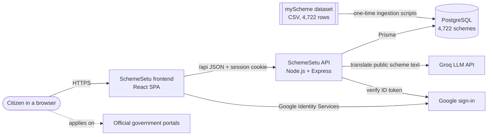
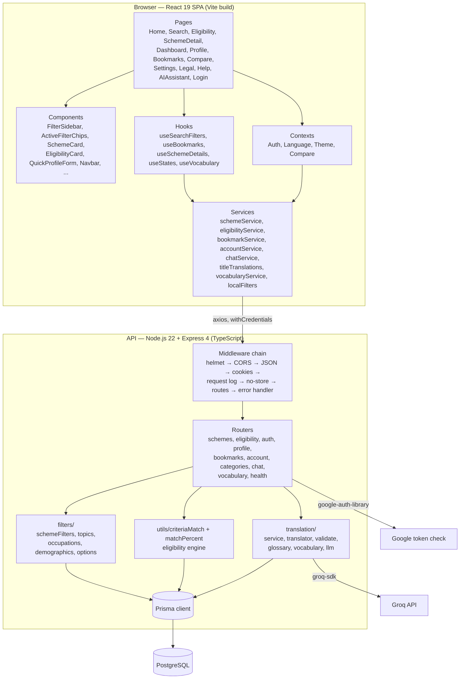
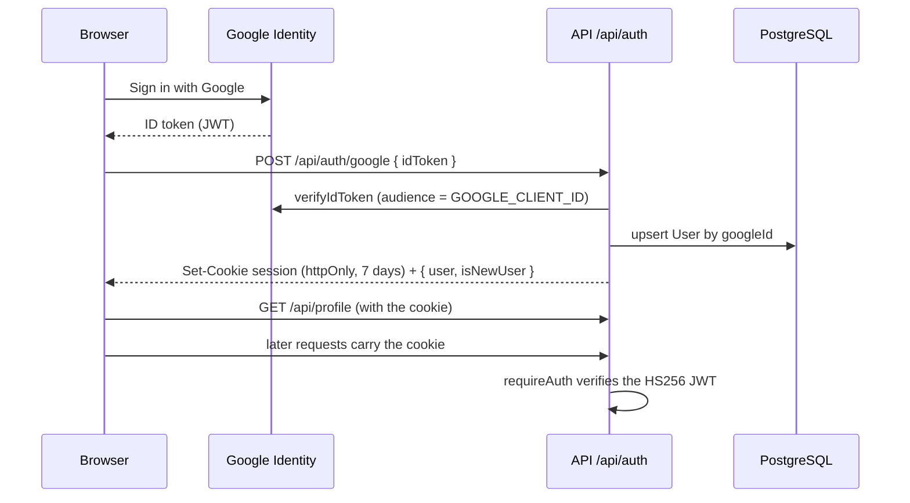
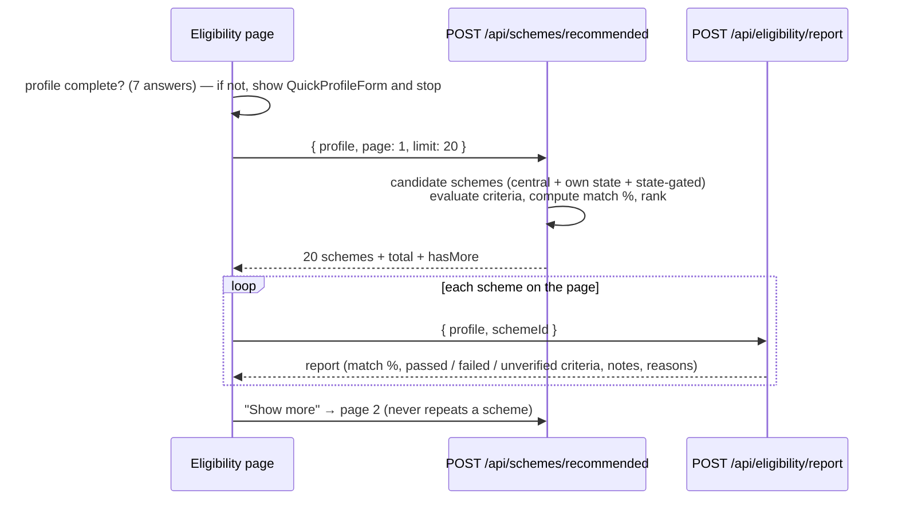
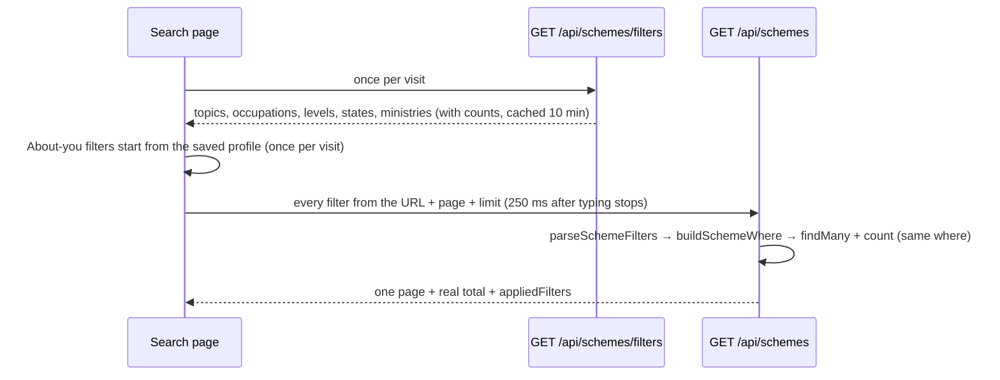
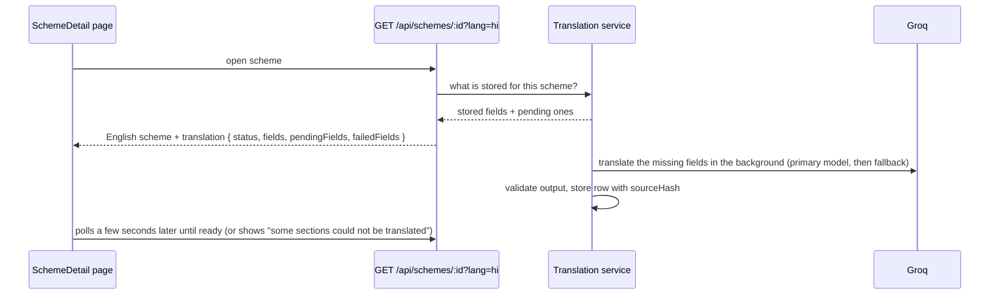
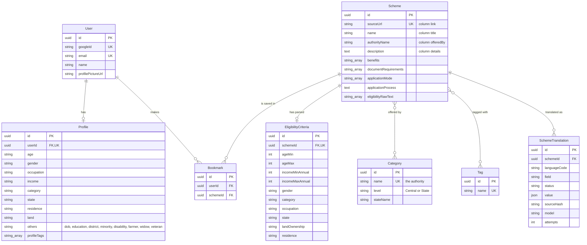
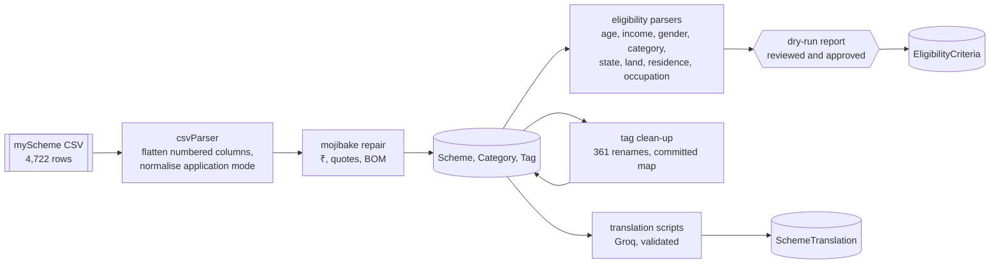
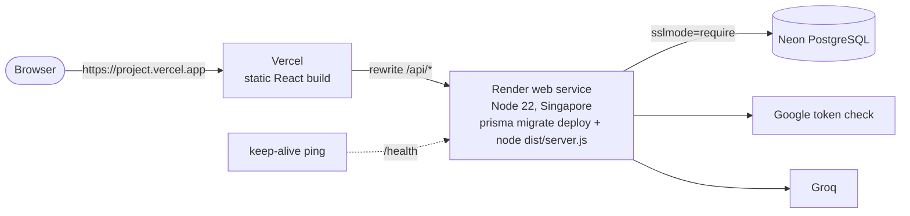

# SchemeSetu — Software Requirements Specification (SRS)

| | |
|---|---|
| **Product** | SchemeSetu (स्कीमसेतु) — a finder for Indian government welfare schemes |
| **Document type** | Software Requirements Specification, structured after IEEE 830 / ISO/IEC/IEEE 29148 |
| **Version** | 1.0 — 2026-10-21 |
| **Project** | Project-I (CEUP 301), Department of Computer Science & Engineering, CSPIT, CHARUSAT — Group CS26015 |
| **Student** | Urja Gajera (24CS021) |
| **Mentor / Guide** | Dr. Jigar Sarda |
| **Repository** | `github.com/Urjagajera/SchemeSetu`, branch `master` (194 commits, 2026-07-13 to 2026-10-21) |
| **Source of every number** | Measured on 2026-10-21 from the code, the local database and the test runs. Nothing is estimated unless it says so. |

> This SRS describes the system **as built**. Requirements are written in the "shall" form; each one is implemented unless it is listed in
> section 16 (Known limitations). The older `docs/SchemeSetu-Project-Book.md` (draft of 2026-10-13) holds the project's decision history and
> working rules; this document supersedes its counts and adds the modules built after it.

---

## Table of contents

1. [Introduction](#1-introduction)
2. [Overall description](#2-overall-description)
3. [System architecture](#3-system-architecture)
4. [Technology stack](#4-technology-stack)
5. [Functional requirements](#5-functional-requirements)
6. [Eligibility engine specification](#6-eligibility-engine-specification)
7. [Search and filter specification](#7-search-and-filter-specification)
8. [Language and translation specification](#8-language-and-translation-specification)
9. [Data requirements](#9-data-requirements)
10. [External interface requirements](#10-external-interface-requirements)
11. [Non-functional requirements](#11-non-functional-requirements)
12. [Quality assurance: testing and CI](#12-quality-assurance-testing-and-ci)
13. [Deployment](#13-deployment)
14. [Project structure](#14-project-structure)
15. [Design and implementation constraints](#15-design-and-implementation-constraints)
16. [Known limitations and future work](#16-known-limitations-and-future-work)
17. [Project deliverables](#17-project-deliverables)
18. [Appendices](#18-appendices)

---

## 1. Introduction

### 1.1 Purpose
India runs thousands of central and state welfare schemes, and a citizen has no simple way to find the few that fit them. SchemeSetu
collects **4,722 schemes** into one searchable catalogue and tells a person, from a few answers about themselves, **which schemes they are
likely to be eligible for and why**. This document specifies what the system does, how it is built, and the qualities it must have.

### 1.2 Intended audience
- The project mentor and examiners (Project-I evaluation).
- Developers maintaining or extending the code.
- Anyone deploying or operating the system.

### 1.3 Product scope
**In scope**
- A public catalogue of 4,722 central and state schemes with free-text search and structured filters.
- An eligibility check: a 3-step guest wizard, and an automatic check from a signed-in user's saved profile.
- A ranked "recommended for you" list with a match percentage and the reasons behind it.
- Scheme detail pages, bookmarks, side-by-side comparison of up to 3 schemes.
- English and Hindi interface and scheme text (Gujarati is built but switched off).
- Google sign-in, a saved profile, account data export and account deletion.
- Privacy Policy and Terms pages.

**Out of scope** (not built and not promised)
- Applying for a scheme inside SchemeSetu (users are sent to the official portal).
- A live AI chat assistant (SetuAI gives fixed answers only).
- Payments, notifications, e-mail, an admin panel, native mobile apps.

SchemeSetu is an **independent information service, not a government website**, and the interface says so.

### 1.4 Definitions, acronyms and abbreviations

| Term | Meaning |
|---|---|
| Scheme | A government welfare programme (central or state) |
| Central / State scheme | Who offers it, derived from the authority name: a state or union territory name means State, anything else Central |
| Authority | The ministry, department or state that offers a scheme (`Scheme.authorityName`) |
| Criteria | The structured eligibility conditions parsed from a scheme's text (`EligibilityCriteria`) |
| Hard criterion | A condition that can exclude a scheme (age, income, gender, social category, state, land, residence) |
| Soft criterion | A condition that only changes ranking and adds a note (occupation) |
| Unknown | A profile answer left blank; it never excludes a scheme |
| Match % | The "Overall match" shown on an eligibility card (section 6.4) |
| Topic | A "What you need" filter group (16 groups built from tags, section 7.3) |
| SC / ST / OBC | Scheduled Caste / Scheduled Tribe / Other Backward Class |
| CSC | Common Service Centre (government-run help kiosks) |
| SPA | Single-page application |
| LLM | Large language model (used here only for Hindi translation) |
| TPD / TPM | Tokens per day / tokens per minute (Groq quota) |
| CI | Continuous integration (GitHub Actions) |

### 1.5 References
- `README.md` — setup and commands.
- `docs/SchemeSetu-Project-Book.md` — decision log, standing rules, history.
- `docs/*.md` — one note per module (account data, compare page, dependency audit, Gujarati hardening, Hindi label, Hindi summaries,
  Hindi title clean-up and fixes, honest copy, privacy and terms, recommended pagination, removed pages, session cookie, UI strings).
- `backend/prisma/schema.prisma`, `backend/prisma/migrations/` — the database.
- `.github/workflows/ci.yml`, `render.yaml`, `vercel.json` — CI and deployment.
- Data source: the myScheme portal of the Government of India (`www.myscheme.gov.in`), as exported into
  `backend/data/final_data_without_process_mode_.csv`.

### 1.6 Overview of this document
Sections 2–4 describe the product, its architecture and technology. Sections 5–8 are the functional requirements, with the eligibility
engine, search filters and translation pipeline specified in detail. Section 9 covers data, 10 the interfaces, 11 the non-functional
requirements, 12–13 testing and deployment, 14 the code layout, 15 constraints, 16 known limitations, and 17 the project deliverables.

---

## 2. Overall description

### 2.1 Product perspective
SchemeSetu is a new, self-contained web application with three tiers: a React SPA, an Express JSON API, and a PostgreSQL database. It depends
on two outside services: **Google Identity** (sign-in) and **Groq** (an LLM API used only to translate public scheme text into Hindi).



### 2.2 Product functions (summary)
1. Browse and search 4,722 schemes; filter by who you are, what you need, and who runs the scheme.
2. Check eligibility (guest wizard or saved profile) and get a ranked list, 100% matches first, with reasons.
3. Open a scheme: description, benefits, eligibility, documents, how to apply, official link, related schemes.
4. Bookmark schemes and compare up to 3 side by side.
5. Keep a profile; answer the missing profile questions right on the dashboard or the eligibility page.
6. Use the app in English or Hindi; read Hindi scheme text with a one-click switch back to the English original.
7. Export or delete one's own account data.

### 2.3 User classes and characteristics

| User class | Description | Sign-in | Main functions |
|---|---|---|---|
| Guest visitor | Anyone arriving at the site; may have low digital literacy; may prefer Hindi | No | Home page, eligibility wizard, Privacy and Terms |
| Signed-in citizen | Has signed in with Google | Yes | Everything: search, scheme pages, profile, recommendations, bookmarks, compare, dashboard, settings, export/delete |
| Helper (NGO / CSC operator, student volunteer) | Uses the app on someone else's behalf | Optional | Same as a citizen; the guest wizard needs no account |
| Operator (project owner) | Runs ingestion and translation scripts, deploys | Not a product user | Works through npm scripts and the hosting dashboards |

There is **no admin role** inside the app and **no demo login**: sign-in is real Google sign-in only.

### 2.4 Operating environment
- **Client:** a current desktop or mobile browser with JavaScript enabled (Chrome, Edge, Firefox, Safari).
- **Server:** Node.js 22 (`engines: node >= 20`), PostgreSQL 14 or newer.
- **Local development:** API on `http://localhost:3001`, Vite dev server on `http://localhost:5173` (it proxies `/api` to 3001), local PostgreSQL.
- **Planned production:** Vercel (frontend), Render (API, Singapore region), Neon (PostgreSQL) — all free tiers (section 13).

### 2.5 Design and implementation constraints (summary; full list in section 15)
- Free tiers only; nothing may cost money (this limits translation volume and hosting).
- Hindi on, Gujarati off until a native speaker reviews it.
- The interface may only state things that are true.
- TypeScript everywhere; both test suites, both typechecks and both builds pass before every push.

### 2.6 Assumptions and dependencies
1. The scheme catalogue is a snapshot of the myScheme dataset; it is refreshed occasionally by re-running the ingestion scripts, not live.
2. Users confirm details on the official portal before applying; SchemeSetu's result is guidance, not a decision.
3. Google Identity and Groq stay available on their free plans. If Groq's daily quota runs out, translation falls back to English visibly.
4. In production the browser reaches the API through the frontend's own address (Vercel rewrites `/api/*` to Render), so the session cookie is first-party.

---

## 3. System architecture

### 3.1 High-level architecture



### 3.2 Request lifecycle (backend middleware order)
Defined in `backend/src/app.ts`; the order matters:

1. `app.set('trust proxy', N)` from `TRUST_PROXY_HOPS` (2 in production: browser → Vercel → Render), and `etag` disabled.
2. `helmet()` — security headers.
3. `cors({ origin: CLIENT_URL, credentials: true })` — one fixed origin, never `*`.
4. `express.json()` — JSON bodies.
5. `cookieParser()` — reads the session cookie for `requireAuth`.
6. `requestLogger` — Pino log line per request (method, path, status, duration).
7. `/api/*` responses get `Cache-Control: no-store`.
8. Routers (section 10.2). `chatLimiter` sits in front of `/api/chat`; `authLimiter` on sign-in.
9. `errorHandler` — one JSON error shape `{ error: { message, status } }`; no stack traces in production.

### 3.3 Frontend architecture
- **Routing** (`src/routes/AppRoutes.tsx`, React Router 7): public routes (`/`, `/login`, `/register`, `/eligibility`, `/privacy`, `/terms`)
  and protected routes. A signed-out visitor who opens a protected route is redirected to `/login?redirect=<route>`.
  Dashboard, Bookmarks, Compare, Profile and Settings share a dashboard layout with a sidebar.
- **State:**
  - `AuthContext` — user, profile, `updateProfile`, Google sign-in, logout. The profile is the single source for "About you" answers.
  - `LanguageContext` — `en` / `hi` / `gu` dictionaries from `locales/*.json`; the choice is kept in `localStorage`.
  - `ThemeContext` — light / dark.
  - `CompareContext` — up to 3 schemes to compare.
  - **The URL** — every Search filter lives in the query string (`useSearchFilters`), so reload, back and shared links keep the same results.
- **Services** wrap every API call with `axios` (`withCredentials: true`) and check that a JSON array or object really came back, so a dev-server
  HTML page is never mistaken for data. `VITE_USE_MOCK_DATA=true` switches to bundled demo data and local filtering (`services/localFilters.ts`).
- **Styling:** Tailwind CSS 4 with a design-token palette (primary navy `#002045`, secondary blue `#1960A3`, light surfaces), fonts Inter and
  Outfit, Framer Motion transitions, Lucide icons, dark mode.

### 3.4 Backend module map

| Folder | Responsibility |
|---|---|
| `routes/` | HTTP endpoints (one router per resource) |
| `filters/` | Search filters: read and check every query parameter in one place (`schemeFilters.ts`), topics (`topics.ts`), occupations (`occupations.ts`), demographic rules (`demographics.ts`), option lists with counts (`options.ts`) |
| `utils/` | Eligibility engine (`criteriaMatch.ts`), match percentage (`matchPercent.ts`), Central/State level (`schemeLevel.ts`), the 36 states and UTs (`states.ts`), profile validation (`profileSchema.ts`), session cookie (`sessionCookie.ts`), scheme serialiser, logger, async handler, trust-proxy parsing |
| `middleware/` | `requireAuth`, rate limiters, request logger, error handler |
| `translation/` | Translation service, model calls with fallback, output validator, glossary, vocabulary (ministry, state and tag names), batch scripts |
| `ingestion/` | CSV parser, mojibake repair, eligibility / demographic / state / land / residence / occupation parsers, tag clean-up, dry-run reports |
| `db/` | One shared Prisma client |
| `config/` | Typed environment configuration (nothing else reads `process.env`) |

### 3.5 Key sequences

**Sign-in**


**Eligibility check (signed in)**


**Search**


**Scheme page in Hindi**


---

## 4. Technology stack

### 4.1 Frontend

| Technology | Version | Purpose |
|---|---|---|
| React | 19.2 | UI library |
| TypeScript | 7.0 | Static typing |
| Vite | 5.4 | Dev server and production build |
| React Router DOM | 7.18 | Client-side routing, URL-based filter state |
| Tailwind CSS (+ `@tailwindcss/postcss`, autoprefixer) | 4.3 | Styling, design tokens, dark mode |
| Framer Motion | 12.42 | Page and component animation |
| Lucide React | 1.24 | Icons |
| React Hook Form + `@hookform/resolvers` | 7.81 / 5.4 | Profile form |
| Zod | 4.4 | Form validation schemas |
| Axios | 1.18 | HTTP client (cookies sent with every request) |
| clsx + tailwind-merge | 2.1 / 3.6 | Class-name composition (`utils/cn.ts`) |
| Google Fonts | — | Inter (body), Outfit (display) |

### 4.2 Backend

| Technology | Version | Purpose |
|---|---|---|
| Node.js | 22 (min 20) | Runtime, ES modules |
| Express | 4.19 | HTTP API |
| TypeScript | 5.4 | Typing; `tsx` in development, `tsc` build for production |
| Prisma (client + CLI) | 5.22 | ORM, migrations |
| PostgreSQL | 14+ (local: 18) | Database |
| google-auth-library | 11.1 | Verifies Google ID tokens |
| jsonwebtoken | 9.0 | HS256 session token |
| cookie-parser | 1.4 | Reads the session cookie |
| helmet | 8.3 | Security headers |
| cors | 2.8 | Fixed-origin CORS with credentials |
| express-rate-limit | 8.7 | Rate limits on sign-in and chat |
| zod | 4.6 | Request validation (profile) |
| groq-sdk | 1.6 | LLM calls for Hindi translation |
| csv-parse | 7.0 | Dataset ingestion |
| pino + pino-pretty | 9.0 / 11.0 | Structured logging |
| dotenv | 16.6 | Local environment files |

### 4.3 AI models (translation only)

| Role | Model (via Groq) | Use |
|---|---|---|
| Primary | `openai/gpt-oss-120b` | Hindi titles, summaries and detail text |
| Fallback | `qwen/qwen3.8-27b` | Used automatically when the primary fails validation or its quota is gone |

Both are on Groq's free plan (about 200,000 tokens per day per model, 8,000 per minute). No user data is ever sent to them.

### 4.4 Testing and tooling

| Tool | Version | Use |
|---|---|---|
| Vitest | 2.1 | Test runner (both halves) |
| Testing Library (React, DOM, user-event) + jsdom | 16.3 / 10.4 / 14.6 / 26.1 | Frontend component and page tests |
| Supertest | 7.3 | Backend HTTP tests |
| GitHub Actions | — | CI on every push to `master` and every pull request |
| Git | — | Version control (master branch only) |

### 4.5 Hosting (planned, free tiers)

| Service | Hosts | Notes |
|---|---|---|
| Vercel (Hobby) | Frontend static build | Rewrites `/api/*` to Render so the cookie is first-party |
| Render (Free web service) | API | Region Singapore; sleeps when idle; health check `/health` |
| Neon (Free) | PostgreSQL | Direct connection string with `sslmode=require` |
| Google Cloud | OAuth client | Allowed JavaScript origin = the Vercel address |

---

## 5. Functional requirements

Priority: **H** high (core), **M** medium, **L** low. All listed requirements are implemented.

### 5.1 Authentication and session

| ID | Requirement | Priority |
|---|---|---|
| FR-AUTH-1 | The system shall let a user sign in with Google only (no passwords, no demo account). | H |
| FR-AUTH-2 | The API shall verify the Google ID token server-side against `GOOGLE_CLIENT_ID` and create the user on first sign-in. | H |
| FR-AUTH-3 | The API shall issue a session as an HS256 JWT in an httpOnly cookie that lasts 7 days (`Secure` + `SameSite=None` in production, `SameSite=Lax` locally). | H |
| FR-AUTH-4 | `GET /api/auth/me` shall return the signed-in user, so a reload keeps the session; the profile is loaded from `GET /api/profile`. | H |
| FR-AUTH-5 | Logout shall clear the cookie with exactly the attributes used to set it (one shared module). | H |
| FR-AUTH-6 | Protected pages shall redirect a signed-out visitor to `/login?redirect=<page>` and return there after sign-in. | H |
| FR-AUTH-7 | Sign-in shall be rate-limited to 20 requests per 15 minutes per client. | M |

### 5.2 Profile

| ID | Requirement | Priority |
|---|---|---|
| FR-PROF-1 | The profile shall hold 16 optional answers: age, date of birth, gender, occupation, education, family income, social category, state, district, residence (rural/urban), minority, disability, farmer, widow, veteran, owns cultivable land — plus interest tags. Only the name is required. | H |
| FR-PROF-2 | A blank answer shall mean "unknown", and saving a blank shall clear a previously saved value. | H |
| FR-PROF-3 | `PUT /api/profile` shall validate every field (zod) and return HTTP 400 with a message per field; the form shall show an error summary, mark the tab that has the error and jump to it. | H |
| FR-PROF-4 | States shall be saved in their canonical spelling from the fixed list of 36 states and UTs. | M |
| FR-PROF-5 | The 7 answers the eligibility check needs (age, gender, state, social category, occupation, income, residence) shall be defined once and used by the dashboard and the eligibility page. | H |
| FR-PROF-6 | **Quick profile form:** when any of those 7 answers is missing, the dashboard and the eligibility page shall ask only the missing questions in place, with the same options and checks as the full form, and save only the answers given (other saved fields stay untouched). | H |
| FR-PROF-7 | The profile page shall follow `?next=<path>` back to that page after a save that completes the 7 answers (internal paths only). | M |

### 5.3 Eligibility check

| ID | Requirement | Priority |
|---|---|---|
| FR-ELIG-1 | A guest shall be able to check eligibility through a 3-step wizard (age and gender; state, occupation and income; social category, residence and land) without signing in. | H |
| FR-ELIG-2 | A signed-in user with a complete profile shall see results immediately from the saved profile. | H |
| FR-ELIG-3 | A signed-in user with an incomplete profile shall first see "Complete your profile first" with the quick profile form; no results are computed until the 7 answers are given. | H |
| FR-ELIG-4 | Results shall be ordered by match percentage, **100% matches first**, then by fewer unanswered criteria, then by relevance (section 6.5). | H |
| FR-ELIG-5 | Results shall load 20 at a time with a "Show more" button; no scheme shall ever appear twice; the header shall show "shown / total". | H |
| FR-ELIG-6 | Each result shall show an eligibility card: match %, verified criteria, missing requirements, unverified criteria ("add this to your profile to check"), "worth checking" notes (occupation), reasons, and an Apply link to the official source. | H |
| FR-ELIG-7 | A blank answer shall never make a scheme ineligible (section 6.2). | H |

### 5.4 Search and filters

| ID | Requirement | Priority |
|---|---|---|
| FR-SRCH-1 | The system shall search name, description, authority and tag names with one free-text box. | H |
| FR-SRCH-2 | The filter sidebar shall have three groups: **About you** (state, age, gender, social category, occupation, family income), **What you need** (16 topics, several can be picked), **Who runs it** (Central / State, and the central ministry). | H |
| FR-SRCH-3 | Every filter shall be applied in the database, so the result count and the pages are exact. | H |
| FR-SRCH-4 | Every option shall show how many schemes it has on its own (`GET /api/schemes/filters`). | M |
| FR-SRCH-5 | Every filter shall live in the URL, so reload, back/forward and shared links keep the same results; "Clear all" shall clear every filter (search text kept). | H |
| FR-SRCH-6 | Each active filter shall appear as a removable chip above the results. | M |
| FR-SRCH-7 | For a signed-in user the About-you filters shall start from the saved profile once per visit, never overriding values the link gives; a "Use my profile" button shall restore them after clearing. | M |
| FR-SRCH-8 | Choosing "State" schemes shall hide the ministry list and drop a chosen ministry (a ministry is a central body). | L |
| FR-SRCH-9 | Old links of the form `?category=Education` shall open the matching topic. | L |
| FR-SRCH-10 | Typing in age, income or search shall wait 250 ms after the last keystroke before asking the server. | L |
| FR-SRCH-11 | Results shall be paged, 15 per page on the Search page (the API allows up to 100). | M |

### 5.5 Scheme detail

| ID | Requirement | Priority |
|---|---|---|
| FR-DET-1 | A scheme page shall show title, authority, level, description, benefits, eligibility text, required documents, application mode and process, tags, and a link to the official source. | H |
| FR-DET-2 | Web addresses inside "How to apply" shall be clickable; the leading "Details" heading present in 4,422 descriptions shall be hidden at display time. | M |
| FR-DET-3 | The page shall list up to 3 related schemes from the same authority. | L |
| FR-DET-4 | In Hindi, each translated section (benefits, eligibility, how to apply, documents) shall have an "English \| हिन्दी" switch that shows the original without another request. | M |
| FR-DET-5 | A machine-translation label shall be shown on Hindi text. | H |

### 5.6 Bookmarks, compare, dashboard, settings

| ID | Requirement | Priority |
|---|---|---|
| FR-BM-1 | A signed-in user shall be able to add, remove and list bookmarks (a scheme at most once per user). | M |
| FR-CMP-1 | A user shall be able to compare up to 3 schemes side by side: title, ministry, category, every benefit, eligibility, documents, with a loading state; translated text polls while pending. | M |
| FR-DASH-1 | The dashboard shall show a greeting, the quick profile form when the profile is incomplete, recommended schemes and trending schemes. | M |
| FR-SET-1 | Settings shall let the user change language and theme. | M |
| FR-SET-2 | **Download my data** shall return a JSON export of the account, profile and bookmarks (`GET /api/account/export`). | H |
| FR-SET-3 | **Delete my account** shall require typing the word DELETE, then remove bookmarks, profile and account in one transaction and clear the session cookie (`DELETE /api/account`). | H |

### 5.7 Language, help and static pages

| ID | Requirement | Priority |
|---|---|---|
| FR-LANG-1 | The interface shall be available in English and Hindi, switchable from the navigation bar; all interface text comes from `locales/en.json`, `hi.json`, `gu.json`. | H |
| FR-LANG-2 | Scheme titles and card summaries shall appear in Hindi when Hindi is chosen (stored for all 4,722 schemes). | H |
| FR-AI-1 | SetuAI shall answer with fixed, pre-written replies for 5 topics (PM Kisan, Ayushman Bharat, scholarships, eligibility, documents) plus a default, and shall say it is not a live assistant. Rate limit: 30 messages per 5 minutes. | L |
| FR-HOME-1 | The home page shall show real counts from the data (4,722 schemes, 36 states and UTs), a search box, and popular topics. | M |
| FR-LEGAL-1 | Privacy Policy and Terms of Service pages shall exist in English, Hindi and Gujarati; a test ties their statements to the code (cookie lifetime, stored fields, export/delete routes). | M |
| FR-ERR-1 | Unknown routes shall show a 404 page. | L |
| FR-THEME-1 | Light and dark themes shall be available. | L |

---

## 6. Eligibility engine specification

Code: `backend/src/utils/criteriaMatch.ts`, `utils/matchPercent.ts`, `routes/eligibility.ts`, `routes/schemes.ts` (`/recommended`).

### 6.1 Criteria and their coverage
Parsed from each scheme's eligibility text into one `EligibilityCriteria` row (2,987 of 4,722 schemes have one).

| Criterion | Type | Compared with profile field | Schemes with it |
|---|---|---|---|
| Age (min/max) | Hard, numeric range | `age` | 763 |
| Annual income (min/max) | Hard, numeric range | `income` | 765 |
| Gender | Hard, set (`male`, `female`, `transgender`) | `gender` (`other` → transgender) | 254 |
| Social category | Hard, set (`general`, `sc`, `st`, `obc`) | `category` | 447 |
| State / UT | Hard, set of state names | `state` | 2,149 (2,133 state schemes, 16 central) |
| Land ownership | Hard (`yes` / `no`) | `land` ("Own cultivable land?") | 41 (34 yes, 7 no) |
| Residence | Hard (`rural` / `urban`) | `residence` | 31 (26 rural, 5 urban) |
| Occupation | **Soft**, set (`student`, `farmer`, `entrepreneur`, `employee`, `unemployed`) | `occupation` | 683 |

Sets are stored as comma-separated values and matched only in exact forms (`x`, `x,…`, `…,x`, `…,x,…`), so `st` never matches inside another value.

### 6.2 Evaluation rules
1. **Unknown never excludes.** A blank profile field gives the result `unknown` for that criterion; the scheme stays and the card lists it
   under "unverified" with a hint to add the answer.
2. A **hard** criterion either passes or fails.
3. **Occupation is soft:** a match ranks the scheme higher (+1), a mismatch lower (−1) and adds a "worth checking" note, but it never excludes
   a scheme and never changes `isEligible` or the match %. A profile occupation of "other", "senior citizen" or blank gives no occupation result.
4. **State:** state-level schemes are offered to residents of that state; central schemes to everyone, unless their text limits them to
   certain states. An unrecognised state counts as unknown.
5. **Land:** a "yes" gate counts only when it is about farming land (house plots or shops do not count).
6. **Parsers favour precision over recall:** a missed condition only shows an extra scheme; a wrong condition would hide one someone could claim.

### 6.3 Candidate set for recommendations
Central schemes, plus schemes whose authority is the profile's state, plus schemes whose stored state set contains the profile's state.
Without a recognised state, all schemes are candidates.

### 6.4 Match percentage (`matchPercent.ts`) — one formula for the card and the ranking

| Case | Overall match |
|---|---|
| At least one hard criterion answered | passed ÷ answered × 100 |
| Criteria on file but none answered | 0 (the card shows "—", nothing could be checked) |
| No criteria on file | tags shared with the profile's interests ÷ the scheme's tags × 100 |

`isEligible` on the card: no failed hard criterion (criteria path), or match ≥ 50% (tag path).

### 6.5 Inclusion and ranking (`POST /api/schemes/recommended`)
**Included** when: every answered hard criterion passes; or criteria exist but none could be answered; or (no criteria) at least one tag
matches the profile's interests; or the scheme has no tags / the profile has no interests.

**Order** (stable across pages):
1. Match % — highest first, so **100% matches come first**.
2. Above 0%: fewer unanswered criteria first.
3. Relevance: criteria confirmed (or tags shared) plus the occupation adjustment (+1 / −1).
4. Scheme id (tie-break, so pages never overlap).

Paging: `page` (default 1) and `limit` (default 20, maximum 50); whole numbers ≥ 1 or HTTP 400. The response adds `page, limit, total, hasMore`.

Measured: a complete profile (Gujarat, SC, female student, age 20, ₹1.5 lakh, rural) gets 506 matches; the first 50 are all 100%.

---

## 7. Search and filter specification

Code: `backend/src/filters/`, `src/hooks/useSearchFilters.ts`, `src/components/FilterSidebar.tsx`, `ActiveFilterChips.tsx`.

### 7.1 Parameters of `GET /api/schemes`

| Parameter | Values | Rule |
|---|---|---|
| `q` (or `query`) | text, max 200 chars | Matches name, description, authority or a tag name (case-insensitive) |
| `topic` | topic ids, comma-separated or repeated | Scheme in **any** chosen topic |
| `category` | old Home-page values ("Education", "Healthcare", …) | Read as a topic alias; a value that is no topic is ignored |
| `level` | `central` / `state` | Derived from the authority name |
| `ministry` | exact authority name | Case-insensitive |
| `state` | one of the 36 states/UTs, any spelling | Central schemes + that state's own, minus schemes limited to other states |
| `occupation` | `student`, `farmer`, `entrepreneur`, `employee`, `unemployed`, `senior citizen` | Scheme meant for it: stored criteria **or** occupation tags |
| `gender` | `male`, `female`, `other` | Schemes open to this gender (unrestricted ones always stay) |
| `socialCategory` | `general`, `sc`, `st`, `obc` | Schemes open to this category |
| `age` | whole number 0–120 | Within the scheme's age range, if it has one |
| `income` | whole number of rupees | Within the scheme's income range, if it has one |
| `page`, `limit` | ≥ 1; limit default 20, max 100 | Pagination |
| `lang` | `hi` | Adds stored Hindi card text |

Invalid values are **dropped, never guessed**. The response echoes `appliedFilters` (the filters as actually applied) and the exact `total`.
Every filter is an AND; the demographic filters follow "schemes available to me" (a scheme without that restriction always stays).

### 7.2 Option lists (`GET /api/schemes/filters`, cached 10 minutes)

| List | Content (counts measured 2026-10-21) |
|---|---|
| Levels | Central 696, State 4,026 |
| States | 36 states and union territories |
| Ministries | 52 central authorities with counts (states are reached through the State filter) |
| Occupations | student 948, farmer 694, entrepreneur 555, employee 441, unemployed 65, senior citizen 92 |
| Genders, social categories | fixed lists |
| Topics | section 7.3 |

### 7.3 Topics ("What you need")
There is no topic column in the data, so each topic is a fixed list of cleaned tag names (`filters/topics.ts`); a scheme can be in several.

| Topic id | Label | Schemes |
|---|---|---|
| education | Education & scholarships | 1,222 |
| welfare | Social welfare | 987 |
| agriculture | Farming, fishing & livestock | 733 |
| business | Business & startups | 667 |
| jobs | Jobs & skills | 464 |
| women | Women & children | 460 |
| workers | Workers & labourers | 439 |
| pension | Pension & senior citizens | 385 |
| research | Research & awards | 379 |
| culture | Arts, culture & sports | 314 |
| loans | Loans & credit | 295 |
| disability | Disability | 278 |
| insurance | Insurance & accident cover | 185 |
| health | Health & medical | 179 |
| housing | Housing | 90 |
| exservicemen | Ex-servicemen | 65 |

525 schemes (11%) fall in no topic; they carry only generic tags such as "Financial Assistance" and still appear when no topic is chosen.
A frontend test checks that the app's topic ids and aliases match the backend's exactly.

---

## 8. Language and translation specification

### 8.1 Interface text
- All interface strings live in `locales/en.json`, `hi.json`, `gu.json`; a parity test fails if a key is missing or empty in any language.
- Hindi is **on**; Gujarati is **off** (`LANGUAGES.gu.enabled = false`, guarded by a test) until a native speaker reviews it.
- Hindi and Gujarati wording is **unverified** by a native speaker.

### 8.2 Scheme text translation pipeline (`backend/src/translation/`)
1. **Storage:** table `SchemeTranslation` — one row per scheme + language + field (`title`, `summary`, `description`, `benefits`, `eligibility`,
   `documents`, `applicationProcess`), with status, the model used, attempts, the error, and a `sourceHash` that marks the row stale when the
   English text changes.
2. **Never waits for the model:** an API call returns what is stored now and starts the rest in the background; the page polls.
3. **Models:** primary `openai/gpt-oss-120b`, automatic fallback `qwen/qwen3.8-27b`; text is sent per field and in chunks.
4. **Validator** — an output is rejected (and the fallback tried) when: too little native script (60% long, 40% medium, 20% short text;
   names the source puts in quotes and the output keeps exactly are not counted), numbers or URLs are lost, the number of lines or list items
   changes, English comes back unchanged, a glossary term is wrong or forbidden, letters from another script appear, or Latin letters are
   glued to native letters.
5. **Glossary:** preferred, acceptable and forbidden renderings (e.g. Hindi uses दिव्यांग; अपाहिज is forbidden).
6. **Vocabulary:** ministry and state names plus 363 tags in Hindi (`GET /api/vocabulary?lang=hi`).
7. **Batch scripts:** `npm run translate:cards` (titles and summaries, resumable, metered against the free quota),
   `npm run scan:translations` (re-checks every stored row).

### 8.3 Coverage (2026-10-21)

| Field (Hindi) | Stored OK | Failed |
|---|---|---|
| title | 4,722 | 0 |
| summary (card text) | 4,722 | 0 |
| description / benefits / eligibility / documents / application process | 17 / 16 / 17 / 16 / 17 | 7 in total |

Detail text is translated **on demand** only: translating it all would need about 10 million tokens, roughly 50 days of one model's free quota.

---

## 9. Data requirements

### 9.1 Entity-relationship model



Unique constraints: `User.googleId`, `User.email`, `Profile.userId`, `Bookmark (userId, schemeId)`, `Scheme.sourceUrl`,
`EligibilityCriteria.schemeId`, `Category.name`, `Tag.name`, `SchemeTranslation (schemeId, languageCode, field)`.

### 9.2 Data volumes (2026-10-21)

| Item | Count |
|---|---|
| Schemes | 4,722 (696 central, 4,026 state) |
| Eligibility criteria rows | 2,987 |
| Authorities (Category rows) | 88 |
| Tags | 4,770 (cleaned from 5,131) |
| Hindi translation rows | 9,534 (4,722 titles, 4,722 summaries, 83 detail fields, 7 failed) |
| Local database size | 67 MB |

### 9.3 Ingestion pipeline (`backend/src/ingestion/`)



- Merge key is the scheme URL, so ingestion is **idempotent** (re-running gives the same result).
- Each data change was dry-run first, reviewed, backed up, then applied with an "additive proof" (nothing outside the intended change moved).
- Repairs: about 3,430 rows with broken characters; numbered columns flattened (tags 1–9, benefits 1–15, eligibility 1–15, documents 1–15);
  application mode normalised to `Online`, `Offline`, `Online - Via CSCs`; 125 rows with exclusion text in the wrong column salvaged.

### 9.4 Migrations
11 committed Prisma migrations, applied with `prisma migrate deploy`: user, scheme and eligibility, application mode as array, category, tag,
bookmark, eligibility demographic fields, profile, profile residence, scheme translation, criteria residence.

### 9.5 Personal data
- **Collected:** Google name, e-mail, profile picture URL and Google id; the profile answers the user gives; bookmarks.
- **Not collected:** passwords, payment data, location tracking.
- **Browser storage:** the httpOnly session cookie and small preferences (language, theme).
- **Sent to third parties:** to Google only for sign-in; to Groq only **public scheme text**, never user data.
- **User rights:** export everything (JSON) and delete everything, from Settings.

---

## 10. External interface requirements

### 10.1 User interface
- Responsive layout from phone width upward; a filter drawer on small screens.
- Navigation bar: Search, SetuAI Assistant, Help Desk, language switcher (English / हिन्दी / ગુજરાતી), theme toggle, Login.
- Signed-in pages use a left sidebar (Dashboard, Bookmarks, Compare, Eligibility, AI Assistant, Profile, Settings).
- Light and dark themes; colours from the design tokens (navy `#002045`, blue `#1960A3`).
- Every interface string comes from the locale files.

### 10.2 API reference
All responses are JSON. Errors: `{ "error": { "message": string, "status": number } }`. "Auth" means the session cookie is required.

| Method | Path | Auth | Request | Response |
|---|---|---|---|---|
| GET | `/health` | — | — | `{ status: "ok", timestamp }` |
| GET | `/api/schemes` | — | query parameters in section 7.1 | `{ data: Scheme[], total, appliedFilters, translation? }` |
| GET | `/api/schemes/filters` | — | — | `{ data: { topics, occupations, levels, states, ministries, genders, socialCategories } }` |
| GET | `/api/schemes/featured` | — | `lang?` | `{ data: Scheme[6] }` |
| GET | `/api/schemes/states` | — | — | `{ data: string[36] }` |
| GET | `/api/schemes/ministries` | — | — | `{ data: string[] }` (every authority) |
| POST | `/api/schemes/recommended` | — | `{ profile, page?, limit? }`, `lang?` | `{ data, page, limit, total, hasMore, translation? }` |
| GET | `/api/schemes/titles` | — | `lang=hi&ids=a,b,…` (≤ 100) | `{ data: { status, titles, summaries, pending, failed } }` |
| GET | `/api/schemes/:id` | — | `lang?` | `{ data: Scheme, translation?: { status, fields, pendingFields, failedFields } }` |
| GET | `/api/categories` | — | — | `{ data: { id, name }[] }` |
| POST | `/api/eligibility/report` | — | `{ profile, schemeId }` | `{ schemeId, schemeTitle, overallMatch, isEligible, passedCriteria, failedCriteria, unverifiedCriteria, notes, reasons, suggestions }` |
| POST | `/api/auth/google` | — (rate-limited) | `{ idToken }` | sets cookie; `{ success, user, isNewUser }` |
| POST | `/api/auth/logout` | — | — | clears cookie; `{ success }` |
| GET | `/api/auth/me` | cookie | — | `{ user }` or 401 |
| GET | `/api/profile` | Auth | — | `{ profile }` |
| PUT | `/api/profile` | Auth | partial profile | `{ profile }` or 400 with per-field messages |
| GET | `/api/bookmarks` | Auth | — | ids of the bookmarked schemes |
| POST | `/api/bookmarks` | Auth | `{ schemeId }` | bookmark (adding twice is harmless) |
| DELETE | `/api/bookmarks/:schemeId` | Auth | — | removed |
| GET | `/api/account/export` | Auth | — | download `schemesetu-my-data.json`: account, profile, bookmarks |
| DELETE | `/api/account` | Auth | — | deletes everything in one transaction, clears cookie; `{ success, deleted: { bookmarks, profile, account } }` |
| POST | `/api/chat/message` | — (rate-limited) | `{ text }` | `{ id, sender: "ai", text, timestamp }` (fixed replies) |
| GET | `/api/vocabulary` | — | `lang=hi` | ministry, state and tag names in Hindi |

### 10.3 Software interfaces

| System | Interface | Data exchanged |
|---|---|---|
| Google Identity Services | Browser button + `google-auth-library` on the server | ID token (`idToken`) in; verified Google id, name, e-mail, picture out |
| Groq API | `groq-sdk`, HTTPS | Public scheme text in; Hindi text out |
| PostgreSQL | Prisma client over TCP (`DATABASE_URL`) | All application data |
| myScheme dataset | One CSV file, read by ingestion scripts | Scheme records |

### 10.4 Communication interfaces
- HTTPS in production; JSON over HTTP locally.
- Cookie-based session (`httpOnly`; `Secure` and `SameSite=None` in production).
- CORS limited to `CLIENT_URL` with credentials.
- In production the browser calls `/api/*` on the Vercel origin, which rewrites to Render.

---

## 11. Non-functional requirements

### 11.1 Security

| ID | Requirement |
|---|---|
| NFR-SEC-1 | Google ID tokens shall be verified on the server; the session shall be a signed HS256 JWT in an httpOnly cookie (7 days). |
| NFR-SEC-2 | Helmet security headers on every response; CORS fixed to one origin with credentials (never `*`). |
| NFR-SEC-3 | API responses shall be `Cache-Control: no-store`; ETags disabled. |
| NFR-SEC-4 | Rate limits: sign-in 20 per 15 minutes, chat 30 per 5 minutes. |
| NFR-SEC-5 | Protected routes use `requireAuth`; account routes take the user id **only** from the session, never from the request. |
| NFR-SEC-6 | `TRUST_PROXY_HOPS` shall match the real number of proxies (2 in production) so client addresses cannot be forged. |
| NFR-SEC-7 | Input validation: profile via zod; search filters drop invalid values; recommended paging rejects bad numbers (400). |
| NFR-SEC-8 | Secrets live only in environment variables and are never printed or committed; `.env` is git-ignored. |
| NFR-SEC-9 | Runtime dependency vulnerabilities shall be fixed; the remaining findings are dev-only (Vite / Vitest majors). |

### 11.2 Privacy
- Collect only what section 9.5 lists; no user data is sent to the translation model.
- A user can export and delete all their data at any time.
- Privacy Policy and Terms state only what the code does (checked by a test).

### 11.3 Performance
- Search and filtering run in the database with one `where` used for both the page and the count.
- Filter option counts are cached in memory for 10 minutes.
- Pages are small: 15 results on Search, 20 per "Show more" on Eligibility.
- Typed filter values wait 250 ms before a request.
- The API never waits for the translation model.
- Known free-tier limit: Render sleeps when idle, so the first request after a pause is slow (a keep-alive ping on `/health` is planned).

### 11.4 Reliability and availability
- A failed filter-option load is not cached; the next request retries.
- If the backend cannot be reached, the services fall back to bundled demo data and say so.
- If Groq's quota is used up, translation falls back to the fallback model and then to English with a visible note.
- Account deletion is one transaction (all or nothing).

### 11.5 Usability and accessibility
- Plain-language labels; filters grouped the way a person thinks (about me, what I need, who runs it).
- Removable filter chips; "Clear all"; filters survive reload.
- Missing profile answers are asked in place, so the user never has to hunt for the profile page.
- Form fields have labels; errors are listed in a summary and next to the field.
- Colour contrast follows the design tokens; light and dark themes. (No formal WCAG audit has been done; see section 16.)

### 11.6 Internationalisation
- English and Hindi interface and scheme text; Gujarati prepared.
- Native digits and ordinals handled by the validator.
- Machine-translated text is labelled, and the English original is one click away.

### 11.7 Maintainability
- TypeScript in both halves; one module per concern (filters, eligibility engine, translation, ingestion).
- Configuration read in one place (`config/env.ts`).
- Each module documented in `docs/`; commits mark module boundaries (`Start:` / `Complete:`).
- Ingestion and translation are reproducible scripts with dry runs.

### 11.8 Portability
- Runs on any host with Node.js 20+ and PostgreSQL 14+; no platform-specific code.
- The frontend is a static build that any static host can serve.

### 11.9 Honesty (product rule)
The interface shall state only true facts: no invented user counts, money figures, contact details or claims. A test (`src/test/honestCopy.test.ts`) guards it.

---

## 12. Quality assurance: testing and CI

### 12.1 Automated tests (2026-10-21)

| Suite | Files | Tests | Tools |
|---|---|---|---|
| Frontend | 30 | 358 | Vitest, Testing Library, jsdom |
| Backend | 38 | 677 | Vitest, Supertest |
| **Total** | **68** | **1,035** | |

What is covered:
- **Backend:** routes (schemes, filters, recommended paging and ordering, eligibility, auth, profile, account, translation), the filter module, the
  eligibility engine and match %, parsers (demographics, state, land, residence, occupation), CSV parsing and mojibake repair, tag clean-up,
  translation validator, glossary and vocabulary, session cookie, states, trust proxy.
- **Frontend:** Search page (filters in the URL, chips, Clear all, profile prefill, typing delay), filter state hook, local filters, Eligibility
  page (gate, paging), quick profile form, Profile form, Compare, Settings, Home, Legal, SchemeDetail, SchemeCard, Navbar, Footer, AuthContext,
  services, locale parity, honest copy.

### 12.2 Testing practices
- Mock only at the edges (HTTP, context hooks, services); fake timers for polling and delays.
- **Mutation-checked tests:** each new test is shown to fail when the behaviour it guards is broken.
- Some frontend tests read backend files (topic ids, cookie settings), so both suites run before every push.

### 12.3 Continuous integration
`.github/workflows/ci.yml` runs on every push to `master` and every pull request, on Node 22:
- **Frontend job:** `npm ci` → typecheck → tests → build.
- **Backend job:** `npm ci` → `prisma generate` → typecheck → tests → build.

The latest pushed commit passed both jobs.

### 12.4 Manual verification
Anything that needs a Google sign-in is checked by the owner in Chrome before a module's "Complete" commit. API behaviour is also checked
against the real local database (for example the topic counts and the 100%-first ordering above).

---

## 13. Deployment

### 13.1 Deployment architecture (planned, free tiers)



### 13.2 Configuration
- `render.yaml`: root `backend`, build `npm ci --include=dev && npx prisma generate && npm run build`, start
  `npx prisma migrate deploy && node dist/server.js`, health check `/health`, auto-deploy off, `TRUST_PROXY_HOPS=2`,
  `SESSION_SECRET` generated by Render; `DATABASE_URL`, `CLIENT_URL`, `GOOGLE_CLIENT_ID`, `GROQ_API_KEY` typed in the dashboard.
- `vercel.json`: framework Vite, output `dist`, `/api/*` rewritten to the Render address, everything else to `index.html`, Git auto-deploy off.
- Data copied to Neon: Category, Tag, Scheme, EligibilityCriteria, SchemeTranslation and the two link tables — **not** User, Profile, Bookmark.

### 13.3 Status
Not deployed yet, on purpose: the hosting accounts and real addresses are still to be created. The Render address in `vercel.json` must be
changed to the real one, and the Vercel origin must be added to the Google OAuth client.

### 13.4 Environment variables (names only)
- **Backend:** `PORT`, `NODE_ENV`, `DATABASE_URL`, `SESSION_SECRET`, `CLIENT_URL`, `GOOGLE_CLIENT_ID`, `TRUST_PROXY_HOPS`, `GROQ_API_KEY`,
  `TRANSLATION_PRIMARY_MODEL`, `TRANSLATION_FALLBACK_MODEL`.
- **Frontend:** `VITE_GOOGLE_CLIENT_ID` (must equal the backend's `GOOGLE_CLIENT_ID`), `VITE_USE_MOCK_DATA`.

### 13.5 Running locally
```bash
npm install
npm --prefix backend install
npm --prefix backend run prisma:generate
npm --prefix backend run dev
npm run dev
```
Then open `http://localhost:5173`. Tests: `npm test` and `npm --prefix backend test`.

---

## 14. Project structure

```
SchemeSetu/
├── src/                         React frontend
│   ├── pages/                   Home, Search, Eligibility, SchemeDetail, Dashboard, Profile, Bookmarks,
│   │                            Compare, Settings, Legal, Help, AIAssistant, Login, NotFound
│   ├── components/              FilterSidebar, ActiveFilterChips, QuickProfileForm, SchemeCard, EligibilityCard,
│   │                            Navbar, Sidebar, Footer, LanguageSwitcher, SectionLanguageToggle, Pagination, ...
│   ├── contexts/                AuthContext, LanguageContext, ThemeContext, CompareContext
│   ├── hooks/                   useSearchFilters, useBookmarks, useSchemeDetails, useStates, useVocabulary
│   ├── services/                schemeService, eligibilityService, bookmarkService, accountService, chatService,
│   │                            titleTranslations, vocabularyService, localFilters, dataSourceStatus
│   ├── utils/                   profileCompleteness, linkify, descriptionText, stateLabel, translationUtils, ...
│   ├── constants/               searchFilters (topic ids and aliases), translations, mock schemes
│   ├── routes/AppRoutes.tsx     route table and auth redirects
│   └── test/                    setup, factories, locale parity, honest copy
├── locales/                     en.json, hi.json, gu.json (interface text)
├── backend/
│   ├── src/
│   │   ├── routes/              schemes, eligibility, auth, profile, bookmarks, account, categories, chat, vocabulary, health
│   │   ├── filters/             schemeFilters, topics, occupations, demographics, options
│   │   ├── utils/               criteriaMatch, matchPercent, schemeLevel, states, profileSchema, sessionCookie, ...
│   │   ├── middleware/          requireAuth, rateLimiters, requestLogger, errorHandler
│   │   ├── translation/         service, translator, validate, glossary, vocabulary, llm, scripts
│   │   ├── ingestion/           csvParser, mojibake, parsers, tag clean-up, dry runs
│   │   ├── db/ config/          Prisma client, typed environment
│   │   ├── app.ts               Express app and middleware order
│   │   └── server.ts            starts the HTTP server
│   ├── prisma/                  schema.prisma + 11 migrations
│   ├── data/                    the myScheme CSV (4,722 rows)
│   └── reports/                 dry-run reports, audits, tag backups
├── docs/                        this SRS, the project book, module notes, poster/
├── brag-output/                 25-second launch video (brag.mp4) and its source
├── .github/workflows/ci.yml     CI
├── render.yaml, vercel.json     deployment
└── package.json, vite.config.ts, vitest.config.ts, tailwind.config.js, tsconfig.json
```

---

## 15. Design and implementation constraints

1. **Free tier only.** No paid service, plan or API; this caps translation at the free Groq quota and hosting at free tiers.
2. **Languages:** Hindi on; Gujarati off until a native-speaker review. All Hindi/Gujarati wording is marked unverified.
3. **Honest interface:** only true statements; machine translation is labelled.
4. **Data changes:** dry run → review → backup → apply → additive proof.
5. **Source control:** `master` branch only; module commits marked `Start:` and `Complete:`; no attribution trailers in commit messages.
6. **Before every push:** both test suites, both typechecks and both builds pass, then CI is confirmed green.
7. **Secrets** are never printed or committed.
8. **Precision over recall** in eligibility parsing.
9. **Unknown is never a failure** in the eligibility engine.

---

## 16. Known limitations and future work

**Product and data**
1. Eligibility parsing does not cover EWS, minority, DNT or PVTG conditions; 168 girl-child schemes keep gender empty on purpose; some
   segmented schemes may carry a single wrong gate.
2. For 149 schemes whose only criterion is occupation, eligibility still follows the older tag path (decision deferred).
3. Hindi detail text (benefits, eligibility, documents, how to apply) is translated on demand only, within the free quota.
4. Criteria labels and a few API messages are English-only, even in Hindi mode.
5. Gujarati is built but off; Hindi and Gujarati wording has no native-speaker review yet.
6. 525 schemes fall in no topic.
7. SetuAI gives fixed answers, not a live assistant.

**Engineering**
8. No end-to-end browser tests, accessibility audit or load tests.
9. Dev-only dependency findings need Vite 8 / Vitest 5 major upgrades.
10. Not deployed yet (section 13.3).

**Future work**
- Deploy on the free tiers and add a keep-alive ping.
- Native-speaker review of Hindi, then Gujarati, then switch Gujarati on.
- Extend the parsers (EWS, minority, DNT/PVTG) with dry runs and review.
- Metered translation of the most-visited scheme pages.
- An accessibility audit (WCAG 2.1 AA) and end-to-end tests.
- A real contact address and a "report a wrong scheme" form.

---

## 17. Project deliverables

| Deliverable | Location |
|---|---|
| Source code (frontend, backend, scripts) | repository root |
| This SRS | `docs/SchemeSetu-SRS.md` |
| Project book (decisions, rules, history) | `docs/SchemeSetu-Project-Book.md` |
| Exhibition poster (A3 PowerPoint + PDF, A4 Word + PDF) | `docs/poster/` |
| Launch video (25 s, 1920×1080, voiceover) | `brag-output/brag.mp4` |

---

## 18. Appendices

### Appendix A — npm scripts

| Frontend | Purpose |
|---|---|
| `dev` | Vite dev server (5173) |
| `build` | Production build to `dist/` |
| `preview` | Serve the build |
| `typecheck` | `tsc --noEmit` |
| `test`, `test:watch` | Vitest |

| Backend | Purpose |
|---|---|
| `dev` | `tsx watch src/server.ts` (3001) |
| `build`, `start` | `tsc` build; run `dist/server.js` |
| `prisma:generate`, `typecheck`, `test` | Prisma client, type check, Vitest |
| `ingest:dry-run`, `ingest:schemes`, `ingest:eligibility` | CSV check; load schemes; load criteria |
| `ingest:demographics-dry-run`, `ingest:state-dry-run`, `ingest:land-residence-dry-run`, `ingest:occupation-dry-run` | Parser dry runs with reports |
| `ingest:tags-dry-run`, `ingest:tags-apply` | Tag clean-up |
| `translate:cards`, `translate:vocabulary`, `scan:translations` | Hindi titles/summaries, vocabulary, stored-text check |

### Appendix B — Requirement traceability (main features to code and tests)

| Requirement | Code | Tests |
|---|---|---|
| FR-SRCH-1…11 | `backend/src/filters/*`, `routes/schemes.ts`, `src/hooks/useSearchFilters.ts`, `src/components/FilterSidebar.tsx` | `filters/*.test.ts`, `routes/schemes.filters.test.ts`, `src/pages/Search.test.tsx`, `src/hooks/useSearchFilters.test.ts` |
| FR-ELIG-1…7 | `utils/criteriaMatch.ts`, `utils/matchPercent.ts`, `routes/schemes.ts`, `routes/eligibility.ts`, `src/pages/Eligibility.tsx` | `utils/criteriaMatch.test.ts`, `utils/matchPercent.test.ts`, `routes/schemes.recommended*.test.ts`, `routes/eligibility.test.ts`, `src/pages/Eligibility*.test.tsx` |
| FR-PROF-1…7 | `routes/profile.ts`, `utils/profileSchema.ts`, `src/pages/Profile.tsx`, `src/components/QuickProfileForm.tsx`, `src/utils/profileCompleteness.ts` | `routes/profile.test.ts`, `src/pages/Profile.test.tsx`, `src/components/QuickProfileForm.test.tsx` |
| FR-AUTH-1…7 | `routes/auth.ts`, `utils/sessionCookie.ts`, `middleware/requireAuth.ts` | `routes/auth.test.ts`, `middleware/requireAuth.test.ts`, `utils/sessionCookie.test.ts` |
| FR-SET-2, FR-SET-3 | `routes/account.ts`, `src/pages/Settings.tsx` | `routes/account.test.ts`, `src/pages/Settings.test.tsx` |
| FR-LANG-1, FR-LANG-2, section 8 | `locales/*`, `backend/src/translation/*` | `src/test/locales.test.ts`, `translation/*.test.ts` |

### Appendix C — Glossary
See section 1.4.
